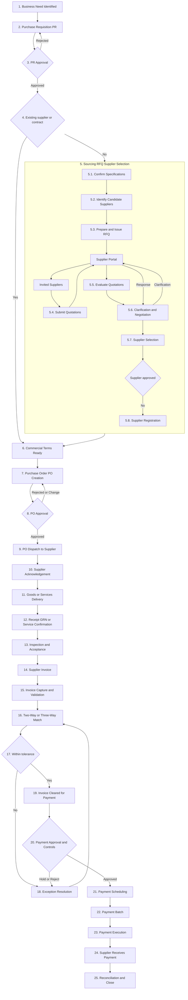
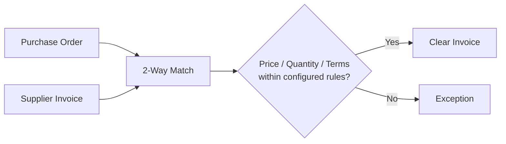
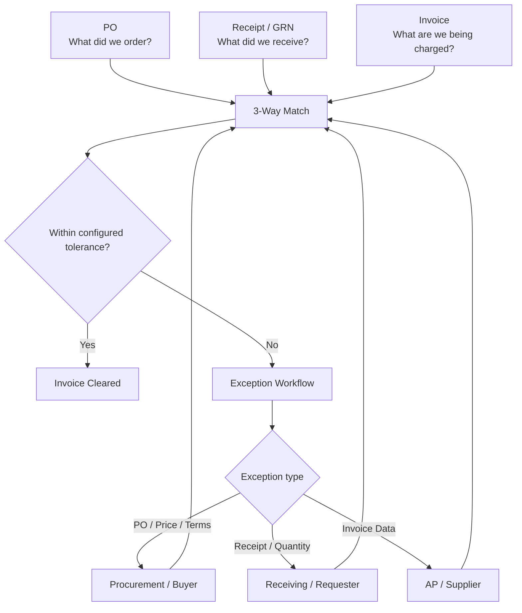
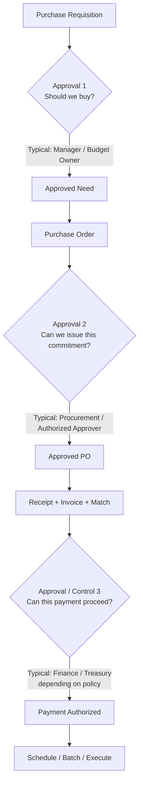
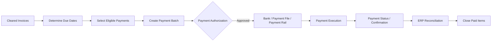
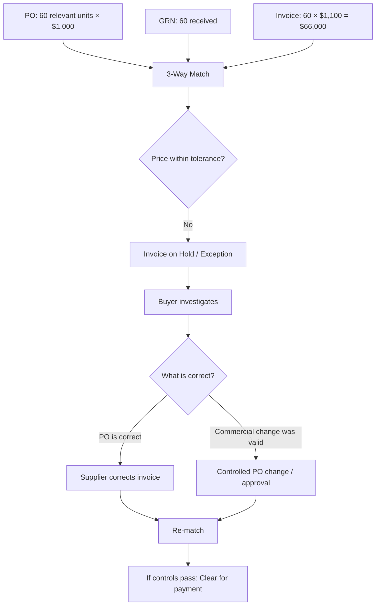
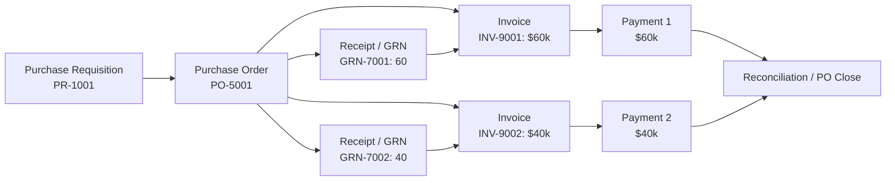
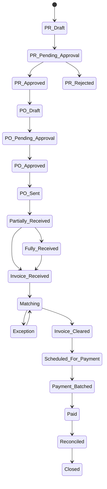

# Procure-to-Pay (P2P) --- Comprehensive Process Reference

> **Purpose:** A practical end-to-end reference for understanding the
> Procure-to-Pay process from the perspectives of the requester,
> approvers, procurement/buyer, supplier, receiving team, Accounts
> Payable (AP), Finance/Treasury, and the P2P/ERP system.
>
> **Source note:** The course material defines P2P as integrating
> procurement and accounts payable to create efficiencies and groups it
> into four stages: **Selecting goods and services → Enforcing
> compliance and order → Receiving and reconciliation → Invoicing and
> payment**. The course's page-25 diagram provides the high-level
> backbone. This document expands that backbone with commonly used
> operational steps (such as GRN, matching, exception handling, partial
> receipts, payment scheduling, and batch execution) to make the
> workflow easier to understand.

------------------------------------------------------------------------

## 1. What is Procure-to-Pay?

**Procure-to-Pay (P2P)** is the operational process that connects the
purchasing side of an organization with Accounts Payable and payment.

At a high level:

**Need → Requisition → Approval → Purchase Order → Supplier → Receipt →
Invoice → Match → Payment Approval → Payment → Reconciliation**

The course groups the process into four stages:

1.  **Selecting goods and services**
2.  **Enforcing compliance and order**
3.  **Receiving and reconciliation**
4.  **Invoicing and payment**

A useful distinction:

-   **Source-to-Contract (S2C)** is generally concerned with
    finding/selecting suppliers, sourcing events, negotiation, and
    contracts.
-   **P2P** operationalizes the purchase and payment.
-   In practice, the boundary can overlap. For example, if a new
    supplier or competitive quotation is needed, sourcing/RFQ activity
    may occur before the PO.

------------------------------------------------------------------------

## 2. Main Personas and Responsibilities

  -----------------------------------------------------------------------
  Persona                             Main Responsibility in P2P
  ----------------------------------- -----------------------------------
  **Requester / Business User**       Identifies the need and raises the
                                      Purchase Requisition (PR).

  **Manager / Budget Owner**          Confirms business need, budget
                                      availability, and authorization.

  **Procurement / Buyer**             Validates purchasing route,
                                      sourcing/supplier where needed,
                                      commercial terms, and PO
                                      creation/management.

  **Procurement / PO Approver**       Authorizes the PO according to
                                      delegation-of-authority rules.

  **Supplier**                        Receives/acknowledges PO, supplies
                                      goods/services, submits invoice,
                                      and receives payment.

  **Receiving / Warehouse / Service   Confirms what was actually received
  Owner**                             or accepted.

  **Accounts Payable (AP)**           Captures and validates invoices,
                                      performs/monitors matching, and
                                      manages invoice exceptions.

  **Finance / Treasury**              Authorizes and/or executes payment
                                      according to company controls.

  **ERP / P2P System**                Routes approvals, stores records,
                                      enforces controls, performs
                                      automated matching where
                                      configured, schedules payments, and
                                      keeps an audit trail.
  -----------------------------------------------------------------------

> Exact job titles and approval ownership vary by organization and
> Delegation of Authority (DoA).

------------------------------------------------------------------------

## 3. End-to-End P2P Master Flow



### What the "hidden" steps add

A high-level course diagram may show only Requisition → Approval → Order
→ Receiving → Invoice → Approval → Payment. In a real implementation,
several controls usually sit between those boxes:

-   budget and authorization checks;
-   supplier/contract validation;
-   supplier acknowledgement;
-   goods receipt or service confirmation;
-   invoice validation;
-   matching and tolerance rules;
-   exception workflow;
-   payment scheduling based on due date/terms;
-   payment batching;
-   bank/payment execution;
-   reconciliation and audit trail.

------------------------------------------------------------------------

## 4. Detailed Step-by-Step Process

### Phase A --- Need, Requisition, and Approval

#### Step 1 --- Identify the need

A business user determines that goods or services are required.

**Example:** IT needs 100 laptops for new employees.

#### Step 2 --- Create Purchase Requisition (PR)

The requester records the requirement in the ERP/P2P system.

Typical information: - item/service description; - quantity; - required
date; - estimated price; - cost center/project; - delivery location; -
suggested supplier, if applicable; - supporting documents.

The **PR is an internal request**. It is not yet an order to the
supplier.

#### Step 3 --- PR Approval

The workflow routes the PR according to company rules.

Possible approvers: - line manager; - budget owner; - cost-center
owner; - project owner; - additional management for high-value
purchases.

Core question:

> **Should the organization spend this money for this requirement?**

Checks may include business justification, budget, value threshold,
category policy, and authorization level.

------------------------------------------------------------------------

### Phase B --- Sourcing, Supplier, and Purchase Order

#### Step 4 --- Determine the purchasing route

Procurement/system determines whether the request can use: - an existing
contract; - an approved supplier; - an existing catalog; - or requires
sourcing/RFQ.

#### Step 5 --- RFQ / Supplier Selection, when required

If sourcing is needed, the buyer can issue an RFQ to candidate suppliers.
A more complete operational flow is:

**Specifications → Identify/Invite Candidate Suppliers → RFQ → Supplier
Portal / eSourcing Channel → Supplier Quotations → Evaluation →
Clarification/Negotiation → Supplier Selection → Supplier Onboarding (if
required)**

The **Supplier Portal / eSourcing Channel** is an interaction channel,
not a separate business approval step. Depending on the platform, it can
support:

-   RFQ invitation and access to RFQ documents;
-   supplier registration/profile information;
-   quotation submission and attachments;
-   buyer/supplier clarification messages;
-   revised quotation submission during negotiation;
-   award/rejection notification;
-   supplier onboarding documents.

The same portal may later support PO acknowledgement, advance shipment or
delivery information, invoice submission, and invoice/payment-status
visibility where those capabilities are enabled.

This sourcing sequence is not necessarily repeated for every P2P
transaction. Existing contracts/catalogs may allow the process to proceed
directly toward a PO.

#### Step 6 --- Validate commercial terms

Confirm, as applicable: - unit price; - quantity; - taxes; - freight; -
Incoterms; - payment terms; - delivery dates; - warranty/service
terms; - contract reference.

#### Step 7 --- Create Purchase Order (PO)

The approved requirement becomes a formal PO.

Typical PO fields: - PO number; - supplier; - ship-to/bill-to; - line
items; - quantities; - unit prices; - taxes; - delivery dates; - payment
terms; - contract/reference data.

#### Step 8 --- PO Approval

The PO may require another authorization before release.

Core question:

> **Can this exact commercial commitment be issued to the supplier?**

This is different from PR approval. PR approval authorizes the
need/spend; PO approval authorizes the purchasing commitment/document.

#### Step 9 --- Dispatch PO

The approved PO is sent electronically or through the organization's
approved channel.

#### Step 10 --- Supplier Acknowledgement

The supplier confirms whether it can meet: - quantity; - price; -
delivery date; - terms.

Discrepancies may create a change/exception before delivery.

------------------------------------------------------------------------

## 5. Receiving and Acceptance

#### Step 11 --- Delivery

Supplier delivers goods or performs the service.

#### Step 12 --- Record Receipt / GRN

The receiving team or service owner records what was **actually
received**.

A **Goods Receipt Note (GRN)** or equivalent receipt record is crucial
because the PO says what was ordered, while the receipt says what
arrived.

#### Step 13 --- Inspection / Service Acceptance

Depending on the purchase, the organization may check: - quantity; -
damage; - specifications; - quality; - completion of service; -
acceptance criteria.

A receipt can be **partial**.

Example:

-   PO quantity = 100 laptops
-   First delivery = 60
-   GRN #1 = 60
-   Remaining open PO quantity = 40

The PO does not have to be fully received before every invoice/payment
scenario. The organization can process an invoice against the quantity
legitimately received, subject to its configured matching and payment
rules.

------------------------------------------------------------------------

## 6. Invoice Processing

#### Step 14 --- Supplier Invoice

Supplier submits an invoice referencing the PO where applicable.

Typical invoice data: - supplier; - invoice number/date; - PO number; -
line items; - quantity; - unit price; - tax; - total; - payment terms; -
bank/payment information according to controlled master data.

#### Step 15 --- Invoice Capture and Validation

AP/system captures the invoice and performs checks such as: - duplicate
invoice detection; - mandatory fields; - supplier validity; - PO
reference; - arithmetic/tax checks; - document format and completeness.

Invoice capture can be manual, electronic, OCR/AI-assisted, EDI,
supplier portal, or other integrated method.

------------------------------------------------------------------------

## 7. Matching --- One of the Most Important Hidden Controls

### 2-Way Match



A **2-way match** compares primarily:

**PO ↔ Invoice**

### 3-Way Match



The three records answer three different questions:

  Record              Question
  ------------------- ----------------------------------------
  **PO**              What did we agree to buy?
  **Receipt / GRN**   What did we actually receive/accept?
  **Invoice**         What is the supplier asking us to pay?

### Tolerance

Matching does not always require literal zero difference. Organizations
can configure tolerances.

Example: - PO unit price: \$1,000 - Invoice unit price: \$1,002 -
configured price tolerance: ±0.5%

The system may automatically accept the difference if policy permits it.
Outside tolerance, it routes an exception.

------------------------------------------------------------------------

## 8. Exception Resolution

Typical exception types and owners:

  -----------------------------------------------------------------------
  Exception               Likely Owner(s)         Example Resolution
  ----------------------- ----------------------- -----------------------
  Price mismatch          Procurement / Buyer     Correct PO or ask
                                                  supplier for corrected
                                                  invoice

  Quantity mismatch       Receiving / Requester / Record missing receipt
                          AP                      or dispute invoice

  Missing receipt         Receiving / Service     Confirm
                          Owner                   delivery/service before
                                                  payment

  Wrong invoice data      AP / Supplier           Correct invoice

  Duplicate invoice       AP                      Block/reject duplicate

  PO issue                Procurement             Amend/correct PO under
                                                  controlled process

  Quality rejection       Receiving / Quality /   Hold
                          Procurement             acceptance/payment;
                                                  resolve with supplier
  -----------------------------------------------------------------------

The system should preserve the exception history and audit trail.

------------------------------------------------------------------------

## 9. Three Different Approval Moments



### Approval 1 --- Business/Budget Approval

**Question:** Should we buy?

### Approval 2 --- PO/Commitment Approval

**Question:** Can this PO be formally issued?

### Approval / Control 3 --- Payment

**Question:** Can this cleared liability proceed to payment?

> **Important:** These roles are illustrative. The exact approver can
> change by company, spend threshold, country, category,
> segregation-of-duties rules, and Delegation of Authority.

------------------------------------------------------------------------

## 10. Persona / Swimlane View

``` mermaid
sequenceDiagram
    participant R as Requester
    participant M as Manager / Budget Owner
    participant P as Procurement / Buyer
    participant S as Supplier
    participant W as Receiving / Service Owner
    participant AP as Accounts Payable
    participant F as Finance / Treasury
    participant SYS as ERP / P2P System

    R->>SYS: Create Purchase Requisition
    SYS->>M: Route PR for approval
    M->>SYS: Approve PR

    SYS->>P: Approved requirement
    opt Sourcing required
        P->>S: RFQ / request quotation
        S->>P: Quotation
        P->>SYS: Select supplier / commercial terms
    end

    P->>SYS: Create PO
    SYS->>SYS: PO approval workflow
    SYS->>S: Dispatch approved PO
    S->>SYS: Acknowledge PO

    S->>W: Deliver goods / services
    W->>SYS: Record receipt / GRN
    W->>SYS: Accept / inspect if required

    S->>AP: Submit invoice
    AP->>SYS: Capture / validate invoice
    SYS->>SYS: 2-way / 3-way match

    alt Match successful
        SYS->>F: Cleared item / payment controls
        F->>SYS: Authorize as required
        SYS->>SYS: Schedule payment
        SYS->>F: Include in payment batch
        F->>S: Execute payment
        SYS->>SYS: Reconcile and close
    else Exception
        SYS->>AP: Flag exception
        AP->>P: PO / price issue if applicable
        AP->>W: Receipt / quantity issue if applicable
        AP->>S: Invoice correction if applicable
    end
```



------------------------------------------------------------------------

## 11. Payment Processing and Batching

Once an invoice has passed the required controls, it does not
necessarily get paid immediately.

### Payment scheduling

The system can schedule payment based on: - invoice due date; - payment
terms; - approved payment calendar; - cash-management rules; -
early-payment discounts where applicable; - payment holds.

### Payment batch

Finance/Treasury can group multiple eligible payments into a periodic
batch.



For example, an organization may execute payment runs daily, twice
weekly, weekly, or according to another controlled schedule.

The key point is:

> **Invoice approval/clearance makes an invoice eligible; payment
> scheduling and batch execution determine when and how the money
> actually moves.**

------------------------------------------------------------------------

# 12. Comprehensive Worked Example --- 100 Laptops

This example follows one purchase from business need to final payment.

## Scenario

**Company:** ExampleCo\
**Requester:** IT Department\
**Requirement:** 100 laptops\
**Supplier:** TechSupplier\
**PO price:** \$1,000 per laptop\
**PO total:** \$100,000\
**Payment terms:** Net 30\
**Delivery:** Supplier delivers 60 first, then 40 later.

------------------------------------------------------------------------

## 12.1 Need and PR

IT expects 100 new employees and needs 100 laptops.

Requester creates:

**PR-1001** - Item: Business Laptop Model X - Quantity: 100 - Estimated
unit price: \$1,000 - Estimated total: \$100,000 - Cost center: IT -
Required date: 15 October

The system checks required fields and routes the PR.

------------------------------------------------------------------------

## 12.2 Approval #1

The IT manager/budget owner reviews: - Is the requirement justified?
**Yes** - Is budget available? **Yes** - Is the requester authorized?
**Yes**

PR-1001 is approved.

------------------------------------------------------------------------

## 12.3 Sourcing / Supplier

Assume no existing contract is suitable.

Procurement issues an RFQ to three suppliers.

  Supplier         Unit Price Delivery   Payment Terms
  -------------- ------------ ---------- ---------------
  Supplier A          \$1,020 10 days    Net 30
  TechSupplier        \$1,000 7 days     Net 30
  Supplier C            \$990 21 days    Net 15

Selection should follow the organization's evaluation criteria; price
alone need not determine the outcome.

For this example, **TechSupplier** is selected.

------------------------------------------------------------------------

## 12.4 PO Creation and Approval #2

Buyer creates:

**PO-5001** - Supplier: TechSupplier - Quantity: 100 - Unit price:
\$1,000 - Total: \$100,000 - Terms: Net 30

The PO goes through the organization's authorization workflow and is
approved.

The system sends PO-5001 to TechSupplier.

Supplier acknowledges it.

------------------------------------------------------------------------

## 12.5 Partial Delivery

TechSupplier initially delivers **60 laptops**.

Receiving verifies the delivery and records:

**GRN-7001** - PO: PO-5001 - Received quantity: 60 - Accepted quantity:
60

System status: - Ordered: 100 - Received: 60 - Remaining: 40

The PO stays partially open.

------------------------------------------------------------------------

## 12.6 First Invoice

Supplier submits:

**INV-9001** - PO: PO-5001 - Quantity: 60 - Unit price: \$1,000 - Total:
\$60,000

### 3-Way Match

  ------------------------------------------------------------------------
  Check                    PO             GRN         Invoice Result
  ----------- --------------- --------------- --------------- ------------
  Quantity        100 ordered     60 received     60 invoiced ✓
  relevant to                                                 
  invoice                                                     

  Unit price          \$1,000             ---         \$1,000 ✓

  Invoice                 ---             ---        \$60,000 ✓ consistent
  amount                                                      
  ------------------------------------------------------------------------

The invoice can pass the matching controls for the **60 received units**
even though the overall PO still has 40 units open, subject to the
organization's rules.

------------------------------------------------------------------------

## 12.7 Payment of First Invoice

INV-9001 is cleared.

The payment terms are Net 30, so the system determines the due date and
places the invoice in the appropriate payment schedule.

On a scheduled payment run:

``` text
Eligible invoices
    ↓
INV-9001 = $60,000
    ↓
Payment Batch PB-001
    ↓
Finance/Treasury authorization
    ↓
Bank/payment execution
    ↓
Supplier receives $60,000
    ↓
ERP reconciliation
```

PO-5001 remains open for the remaining 40 laptops.

------------------------------------------------------------------------

## 12.8 Second Delivery

Supplier later delivers the remaining **40 laptops**.

Receiving records:

**GRN-7002** - Received: 40 - Accepted: 40

Cumulative status: - Ordered: 100 - Received: 100 - Remaining: 0

------------------------------------------------------------------------

## 12.9 Second Invoice

Supplier submits:

**INV-9002** - Quantity: 40 - Unit price: \$1,000 - Total: \$40,000

The system matches:

**PO-5001 ↔ GRN-7002 ↔ INV-9002**

If everything is within tolerance, INV-9002 is cleared and enters the
appropriate payment run.

After payment and reconciliation:

-   Total ordered = 100
-   Total received = 100
-   Total invoiced = \$100,000
-   Total paid = \$100,000
-   PO remaining = 0
-   PO can be closed.

------------------------------------------------------------------------

# 13. Worked Exception Example

Now change the first invoice:

-   PO price = \$1,000/unit
-   Received = 60 units
-   Invoice quantity = 60
-   **Invoice price = \$1,100/unit**

Invoice total = **\$66,000**.



This demonstrates why the matching layer matters: the system should not
blindly pay an invoice merely because the supplier submitted it.

------------------------------------------------------------------------

# 14. Document and Data Relationships



One PO can therefore relate to: - multiple receipts; - multiple
invoices; - multiple payments.

This is why a P2P system tracks **document relationships and remaining
quantities/amounts**, not just a linear sequence of files.

------------------------------------------------------------------------

# 15. Status Model

A simplified lifecycle might look like:



Actual systems can maintain independent statuses for PO, receipt,
invoice, and payment rather than one global status.

------------------------------------------------------------------------

# 16. Control Points

Important control points across the flow include:

1.  **Budget control** --- prevent unauthorized or unfunded spend.
2.  **Delegation of Authority** --- ensure the correct approver acts at
    each threshold.
3.  **Approved supplier / supplier-master controls**.
4.  **Contract/catalog compliance**.
5.  **Segregation of Duties (SoD)** --- avoid inappropriate
    concentration of request, approval, receipt, invoice, and payment
    powers.
6.  **PO approval before supplier commitment**.
7.  **Receipt/acceptance evidence**.
8.  **Duplicate invoice detection**.
9.  **2-way/3-way matching**.
10. **Tolerance controls**.
11. **Payment authorization**.
12. **Controlled supplier bank-detail changes**.
13. **Audit trail**.
14. **Reconciliation**.

------------------------------------------------------------------------

# 17. Where Automation Fits


Possible technologies include: - ERP/P2P workflow; - e-catalogs; -
supplier portals; - electronic PO/invoicing; - OCR/AI invoice
extraction; - rule-based matching; - automated approval routing; - RPA
for repetitive activities; - analytics and supplier-performance
reporting.

Automation should enforce controls rather than merely accelerate an
uncontrolled process.

------------------------------------------------------------------------

# 18. Course View vs Expanded Operational View

  -----------------------------------------------------------------------
  Course-Level View                   Expanded Operational View
  ----------------------------------- -----------------------------------
  Requisition                         Need → PR → validation

  Approval                            Business/budget approval workflow

  Order Creation                      sourcing/contract check → PO
                                      creation

  Order Approval & Dispatch           PO authorization → electronic
                                      dispatch → supplier acknowledgement

  Receiving                           delivery → receipt/GRN →
                                      inspection/acceptance

  Invoice Processing                  capture → validation → duplicate
                                      checks → matching

  Approval                            exception clearance and/or
                                      finance/payment controls according
                                      to policy

  Payments                            schedule → batch → authorization →
                                      execution → reconciliation
  -----------------------------------------------------------------------

The course view is useful for understanding the process at a glance. The
expanded view explains what a real P2P implementation typically needs to
control and automate.

------------------------------------------------------------------------

# 19. Key Takeaways

-   **PR ≠ PO.** The PR is an internal request; the PO is the formal
    purchasing commitment sent to the supplier.
-   **Receiving is a financial control**, not merely a warehouse
    activity, because it provides evidence of what was actually
    delivered/accepted.
-   **PO, Receipt, and Invoice serve different purposes** and together
    enable 3-way matching.
-   **Partial delivery can lead to partial receipt, partial invoicing,
    and partial payment**, while the PO remains open for the balance.
-   **An approved invoice is not necessarily paid immediately.** It can
    be scheduled according to due date and included in a later payment
    batch.
-   **Exceptions are part of the normal workflow.** A mature P2P process
    routes them to the right owner instead of bypassing controls.
-   **Personas and approvals matter.** The system must know not only
    what step occurs, but who is authorized to perform or approve it.
-   **The ERP/P2P system is the orchestration and audit layer**
    connecting procurement, receiving, AP, finance, and the supplier.

------------------------------------------------------------------------

## 20. One-Line Mental Model

> **Request what you need → authorize the spend → formally order it →
> confirm what arrived → validate what the supplier billed → match the
> evidence → authorize/schedule the liability → pay → reconcile and
> close.**
