# Round-1 re-walk — RFQ-aware matching and RFQ basket split on «مطاعم رواق» (2026-10-30)

The round-1 flow ([`../round-1/README.md`](../round-1/README.md); last run on this workspace in
[`../../gcc/rounds/flow-review-2026-10-28/`](../../gcc/rounds/flow-review-2026-10-28/README.md)) run again on hosted
after specs 023 (RFQ-aware matching, PPS-95) and 024 (RFQ basket split, PPS-96) were merged and deployed. It is
the live check for 023 T035 and 024 T037, and the deploy proof for 024 T036: the extraction worker must fill the
«العبوة» pack on fresh replies, and the optimiser must price the split only from this RFQ's replies. Run as
`pp-sa-owner` through Claude in Chrome; the owner's email is masked in every screenshot.

Quotes: [`../../gcc/setup/quotes/gen_quotes_rewalk.py`](../../gcc/setup/quotes/gen_quotes_rewalk.py) (SAR, 15% VAT
included, free delivery). الذهبي `DH-26-1252` **4,147** (rice 85, oil 151, sugar 39, flour 81 per pack); الوفرة
`WF/2026/0781` **4,137** (rice 87, oil 145, sugar 35, flour 84). الذهبي is cheaper on rice and flour, الوفرة on
oil and sugar, so the split should come to **4,063**, 74 below the best single supplier.

## 023 — RFQ-aware matching

### 1. Send the RFQ

RFQ `9de0a3ce` for 4 lines in packs: basmati rice 10 kg ×25, sunflower oil 18 L ×6, white sugar 10 kg ×12, flour
45 kg ×8, to الذهبي للتموين and الوفرة للمواد الغذائية, needed by 6 Nov 2026, terms «الأسعار شاملة التوصيل إلى
الفرع، والعرض سارٍ 14 يومًا.» Save as draft, then Send: «تم إرسال طلب عرض الأسعار. عدد الموردين: 2». The lines kept
the order they were entered in (R2, fixed in #314), and the email went out in Arabic.

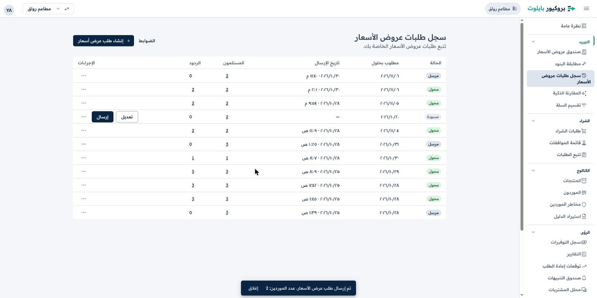

### 2. Supplier replies

Each supplier replied from Gmail as a reply to its own RFQ message, from its send-as alias to
`mtaam-rwaq@mail.procurepilot.iron-sys.com`, body «مرفق عرض السعر المطلوب.», PDF attached. Both were captured
against the RFQ within a minute (responses `7e175273`, `70520e86`) and extracted: الذهبي `a801fd0b` SAR 4,147,
الوفرة `88ba85e8` SAR 4,137.

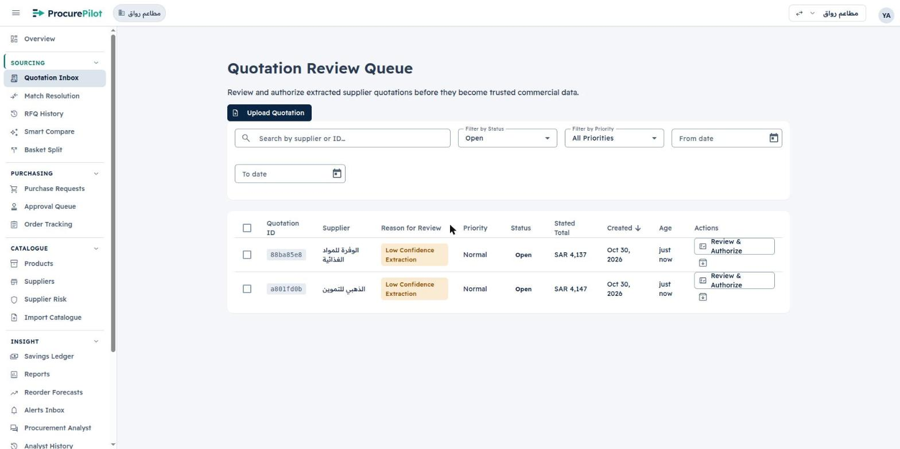

### 3. Review and authorize

Both quotes opened with «Arithmetic Verified» (stated total = computed lines total) and one flagged field, the
expiry date, read correctly (09/11 and 10/11/2026). **The «العبوة» column now reaches the review**: every line's
Pack Details is filled («1 × 10.0 kilogram», 18 L, 45 kg), which was empty in the 2026-10-28 run (R9). On hosted
all 8 lines carry `pack_count = 1` and the right `unit_size` / `pack_unit`, so the extraction worker running is
the #327 image. Unit prices show without trailing zeros («85», #360). **Confirm as-is** on the expiry date, then
**Confirm & Authorize**: the button reads «Authorizing quotation…» until the answer arrives (R7, fixed in #360),
then «Reviewed & Authorized» with the «Next step: Match lines» banner.

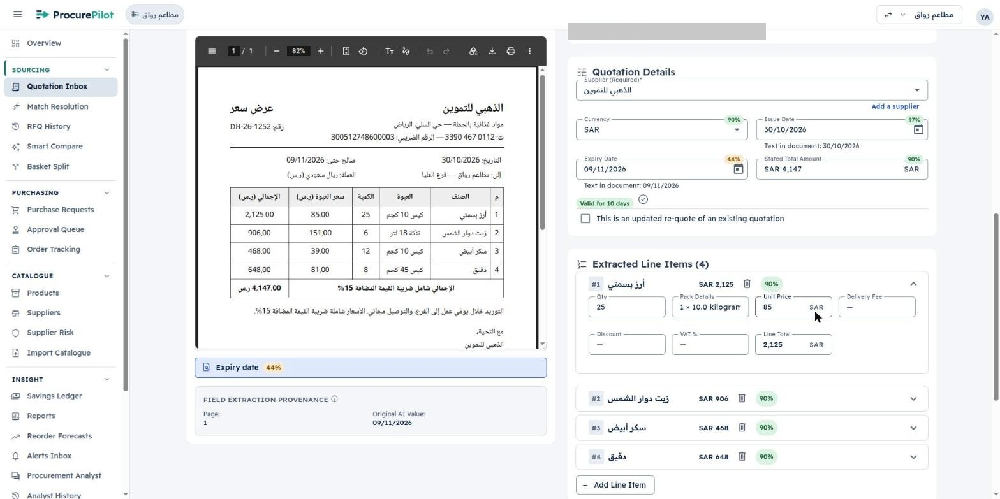

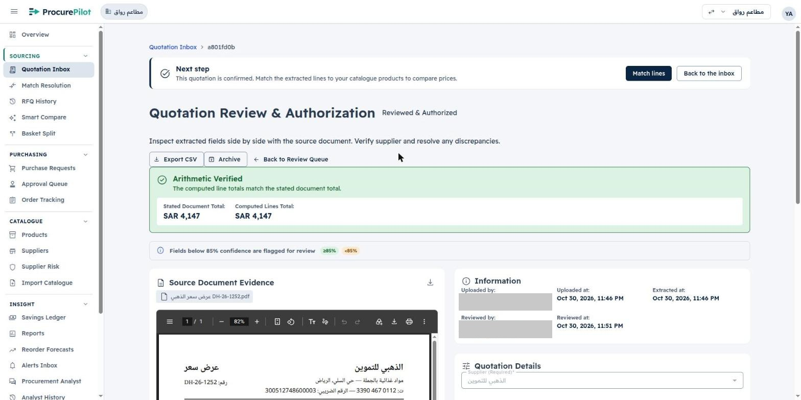

### 4. Matching: nothing to do by hand

All 8 lines were matched automatically on authorization, each to the product on its RFQ line, at 100%
(`same_product`, automatic, confidence 1.0; the same four products for both suppliers). Match Resolution for each
quote says «تمت مطابقة جميع بنود عرض السعر هذا» (0 open of 4); with «All statuses» every line shows «مطابق تلقائياً»
and the chip «من بند طلب التسعير N» (From RFQ line N). On 2026-10-28 the same lines were matched at 97% by the
general matcher, and in Egypt round 1 every line needed a human decision.

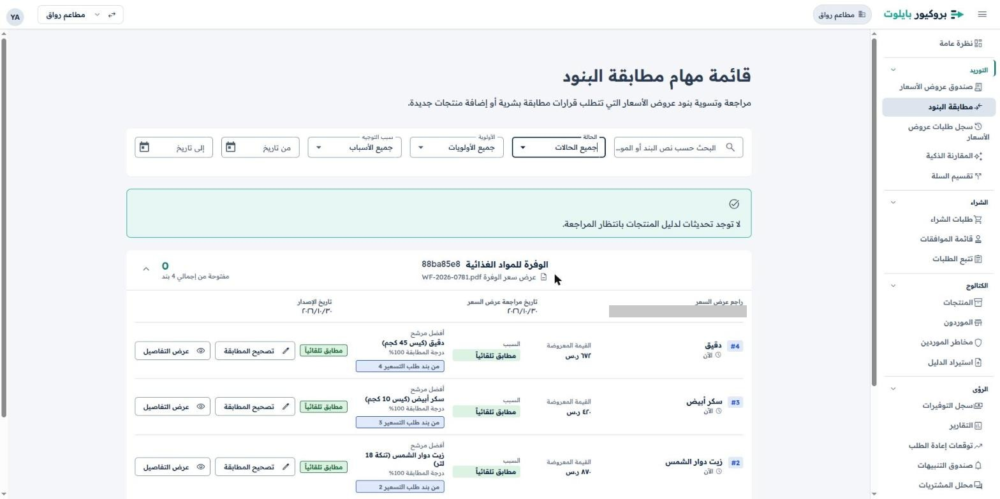

The workspace guardrail (SAR 10,000) was disabled for this walk before authorizing and re-enabled afterwards:
once every reply is matched, it would prepare a single request from الوفرة and convert the RFQ, and a converted RFQ
cannot be split (024 spec, edge cases).

## 024 — RFQ basket split

### 5. Compare and split

After #352 deployed, RFQ compare shows one «تقسيم بين المورّدين» (Split between suppliers) button for the
RFQ, not one per reply. الذهبي 4,147, الوفرة 4,137 «أقل إجمالي», every line at the quoted per-pack price.

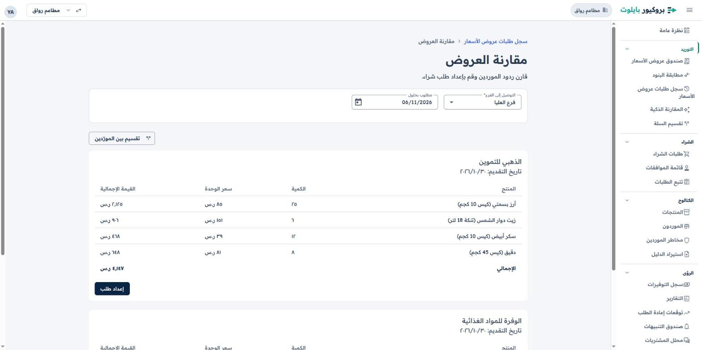

**Split** opens Basket Split already filled from the RFQ («من طلب عروض الأسعار 9de0a3ce»: both suppliers,
the four lines in packs) and the result arrives in seconds (job `21fbb8b1`), «ثقة المحلّل: عالية»:

| Supplier | Lines | Landed cost (SAR) |
|---|---|---|
| الذهبي | rice 25 × 10 kg, flour 8 × 45 kg | 2,773 |
| الوفرة | oil 6 × 18 L, sugar 12 × 10 kg | 1,290 |
| **Split** | | **4,063**, against الوفرة alone 4,137 and الذهبي alone 4,147: saves **74** |

These are exactly the prices in the two replies. The workspace holds other offers for the same products
(the 2026-10-28 quotes at 86 / 150 / 38 / 82 and 88 / 146 / 36 / 85), so the optimiser priced the split
only from this RFQ's replies: the optimiser running is the #341 image (024 T036).

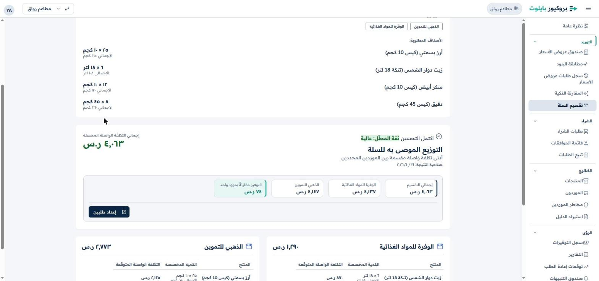

### 6. Prepare two requests and submit them as one

**إعداد طلبين** (Prepare 2 requests): branch فرع العليا and needed-by 06/11/2026 pre-filled, cost centre
المطبخ — العليا chosen. Two draft requests: الوفرة 1,290 and الذهبي 2,773, each «لا توجد ميزانية محددة».

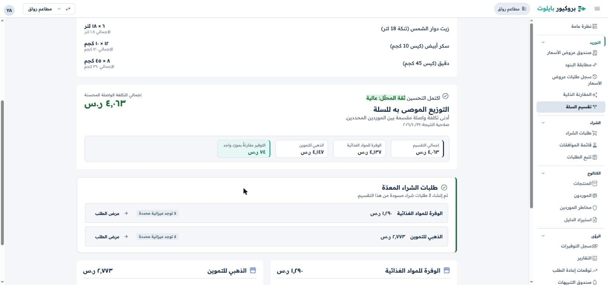

Each request reads «جزء من تقسيم · 2 من 2 · ٤٬٠٦٣ ر.س», links the other request, and offers one button,
«إرسال كلا طلبي هذا التقسيم» (Submit both requests of this split). The list then shows both «مقدمة»
(Submitted), «تقسيم 1 من 2» and «تقسيم 2 من 2».

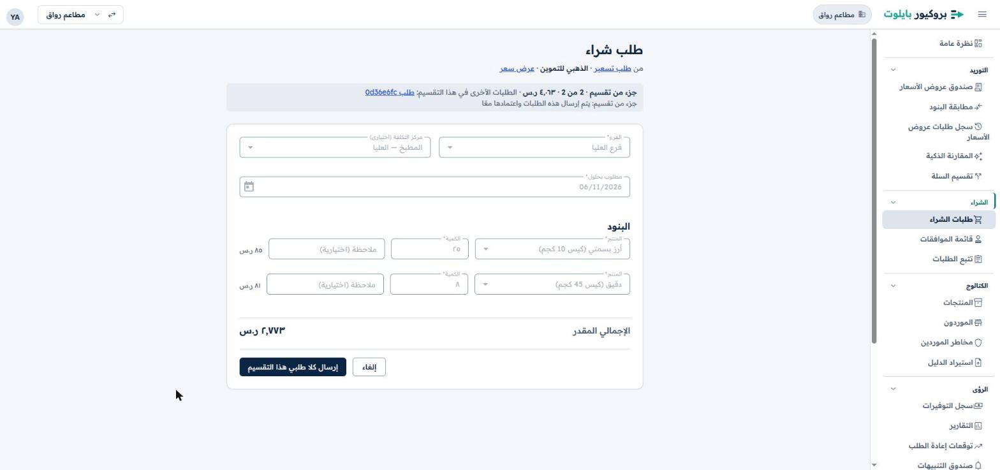

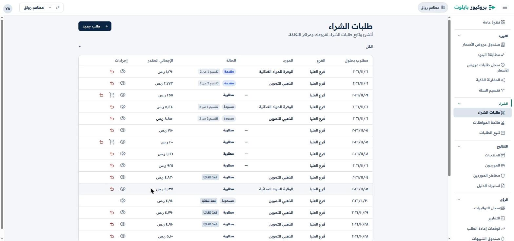

### 7. Approve as one: web queue, then the phone

The web Approval Queue has **one row** for the split: «تقسيم من طلب تسعير 9de0a3ce · طلبان · ٤٬٠٦٣ ر.س · يوفر
٧٤ ر.س», requester «المالك» (a name, not the email: PPS-125), each supplier's budget status, and the four lines
grouped by supplier.

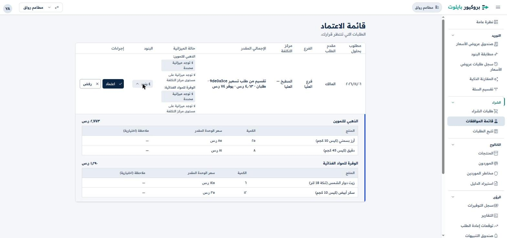

The split was approved on the phone (Flutter web build of `main` at phone width, API proxied by
`docs/gtm/video/source/record/mobile_proxy.py`). **The phone's queue was empty at first** and its home said
«0 طلب(ات) بانتظار قرارك»: `GET /approvals/pending` returned both requests, but the app failed to read them
because their budget status has no remaining amount (`remaining_amount: null`, «no budget»), which the API has
sent since #112 and the app never accepted. Nothing without a budget could be approved on the phone, on any
workspace. Fixed in PPS-137 (`BudgetStatus.remainingAmount` optional; the screens show «No budget configured»
and the reason); the walk continued on a build of that fix.

With the fix: home «2 طلب(ات) بانتظار قرارك», one card for the split, and its decision screen lists both
requests with their totals, «لا توجد ميزانية محددة» and the reason, under «إجمالي التقسيم: ٤٬٠٦٣ ر.س».
**اعتماد** once: both requests are `ordered`, and the queue is empty.

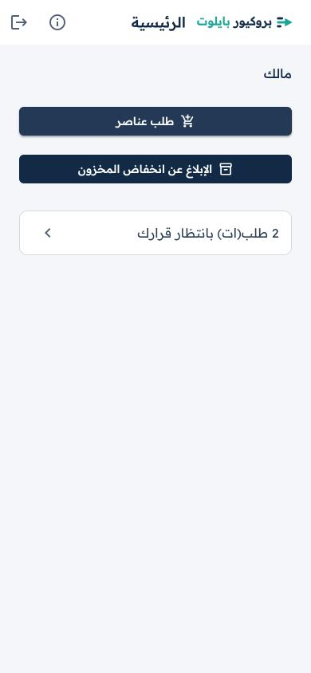

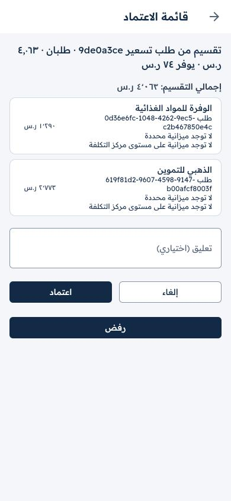

### 8. Two purchase orders

Each request offers **إنشاء أمر شراء**; the form is pre-filled from it («من طلب شراء معتمد — الذهبي للتموين،
فرع العليا»), and the page goes straight to the new order (#348).

| PO | Supplier | Lines | Total (SAR) |
|---|---|---|---|
| PO-000010 | الذهبي للتموين | rice 25 × 85, flour 8 × 81 | 2,773 |
| PO-000011 | الوفرة للمواد الغذائية | oil 6 × 145, sugar 12 × 35 | 1,290 |

Both are drafts; ProcurePilot sends nothing to suppliers.

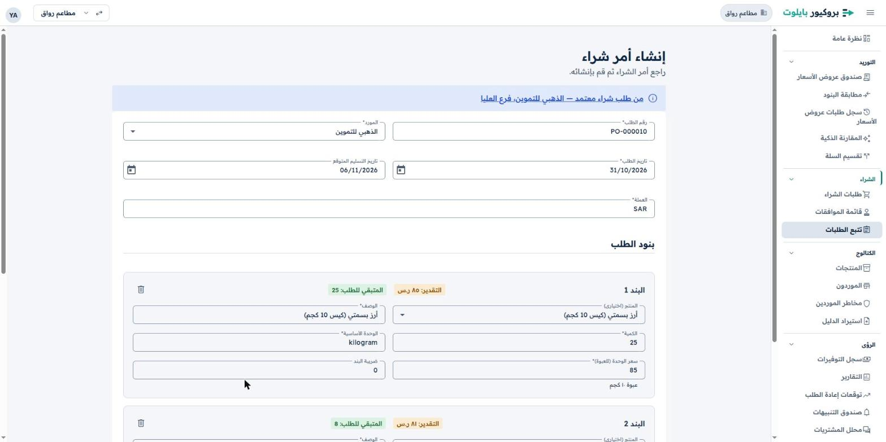

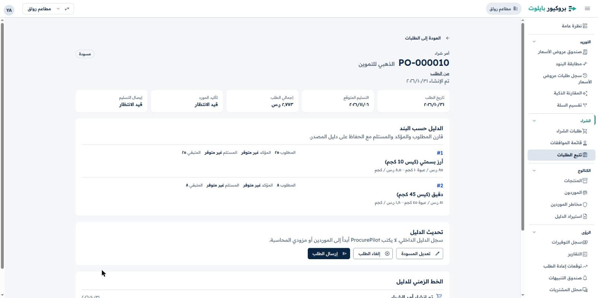

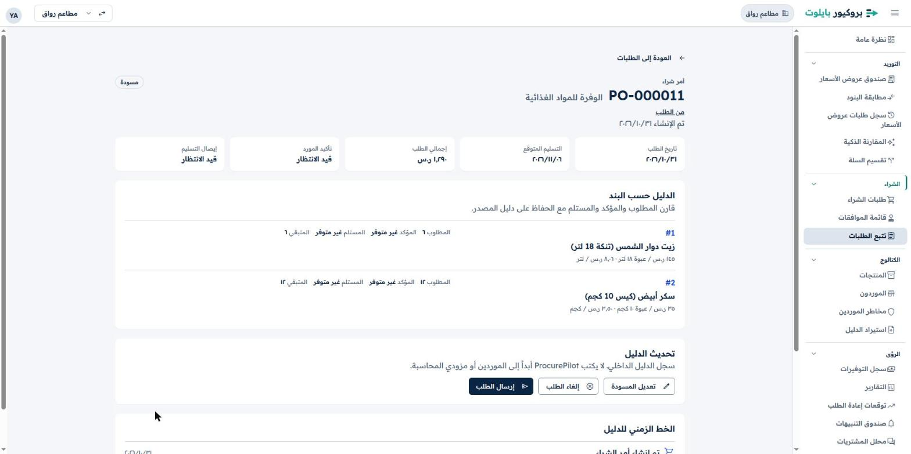

The guardrail was re-enabled after the two POs existed.

## Findings

| # | Where | Finding | Status |
|---|---|---|---|
| W1 | Phone, Approval Queue | Requests with no budget made the whole pending list fail to load (count 0). | Fixed: PPS-137 |
| W2 | RFQ split vs guardrail | With an enabled guardrail, the guardrail prepares a single request as soon as every reply is matched and converts the RFQ, so a split can never be prepared on that RFQ (by design in 024's edge cases). On a workspace with a guardrail the split is unreachable in practice. | Open: product decision |
| W3 | Prepare requests dialog | The cost-centre list offers every branch's cost centres (Olaya, Malqa, Jeddah) for فرع العليا. | Open |
| W4 | Split submit | After «Submit both requests of this split» the toast is the single-request one, «تم إرسال طلب الشراء للاعتماد.» | Open |
| W5 | Phone, split decision | Each request is shown by its full UUID («طلب 0d36e6fc-1048-…»), and the queue card is plain text with no card frame. | Open |
