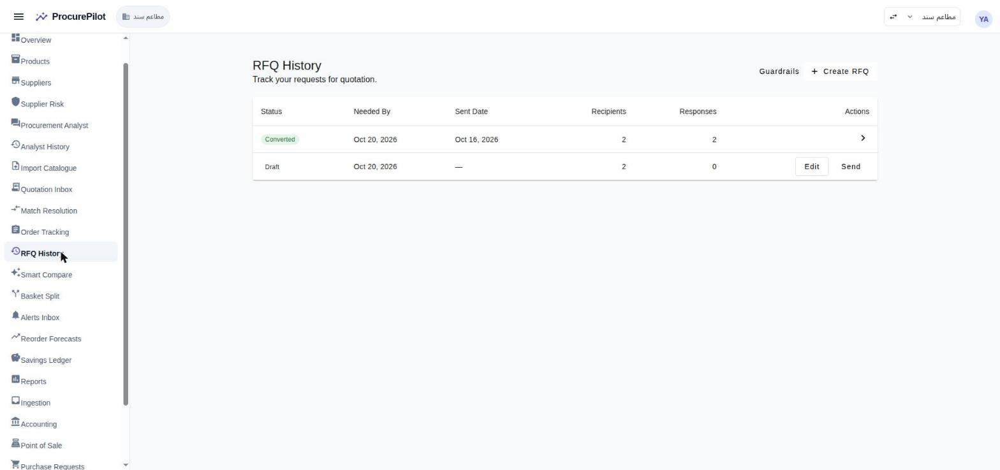
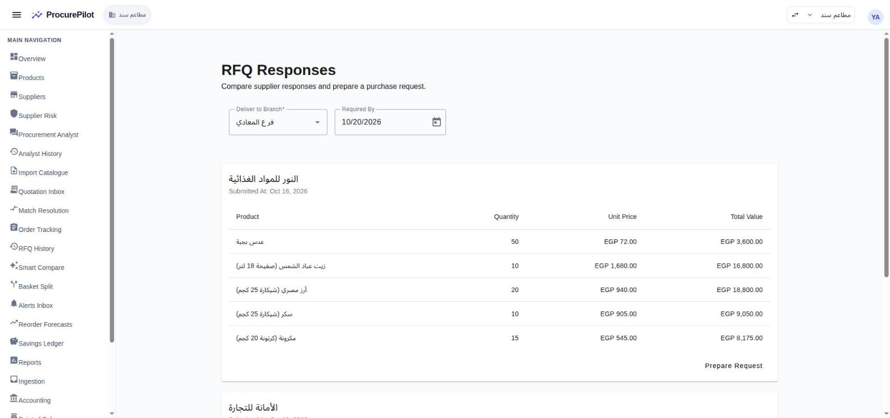
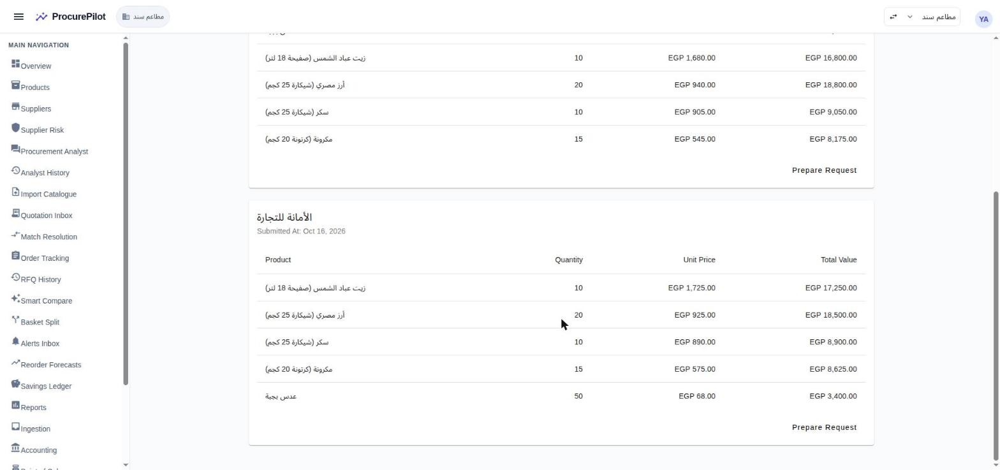
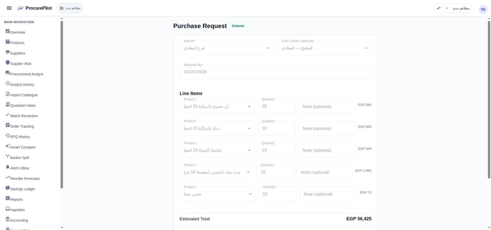
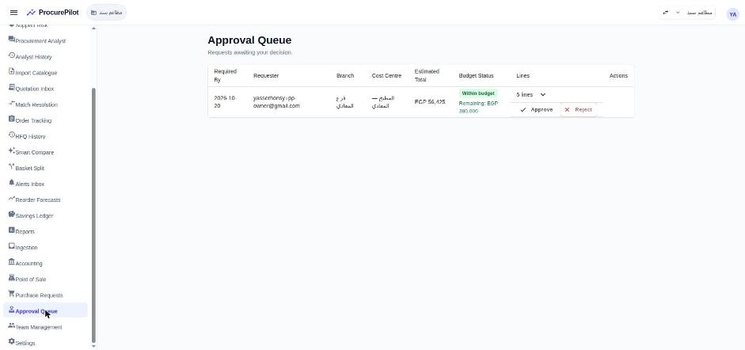
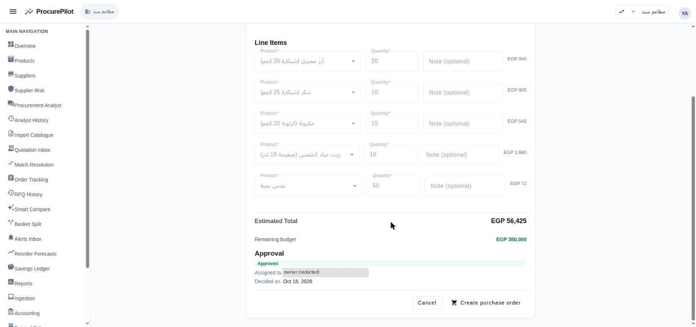
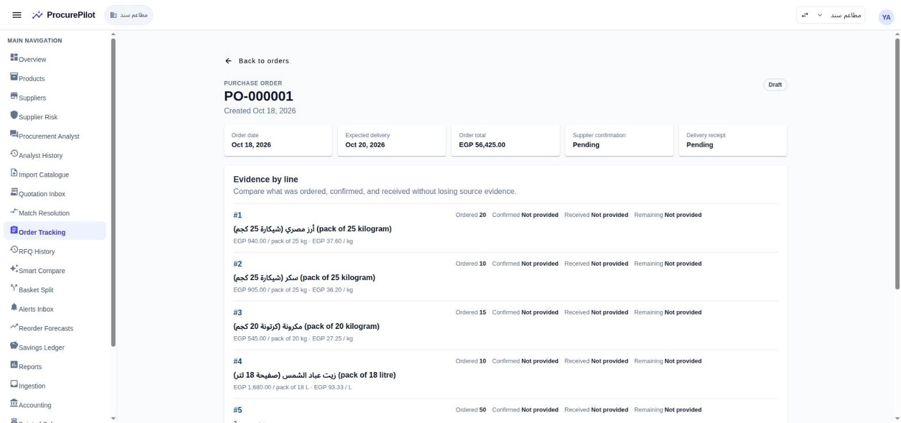
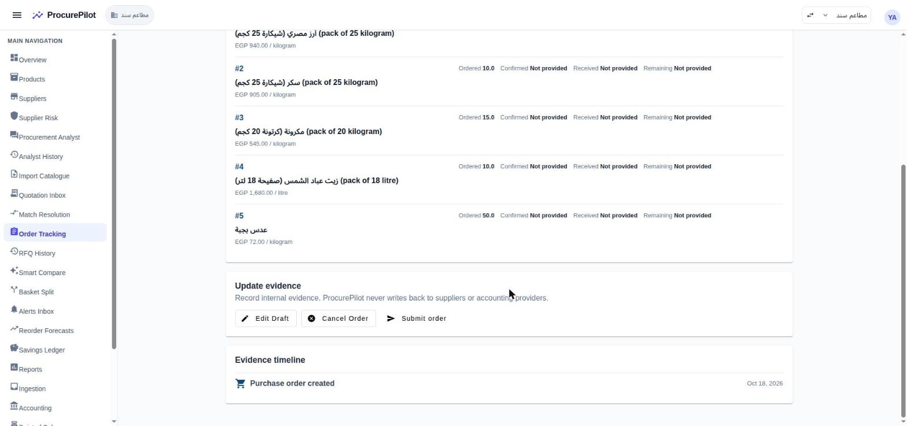
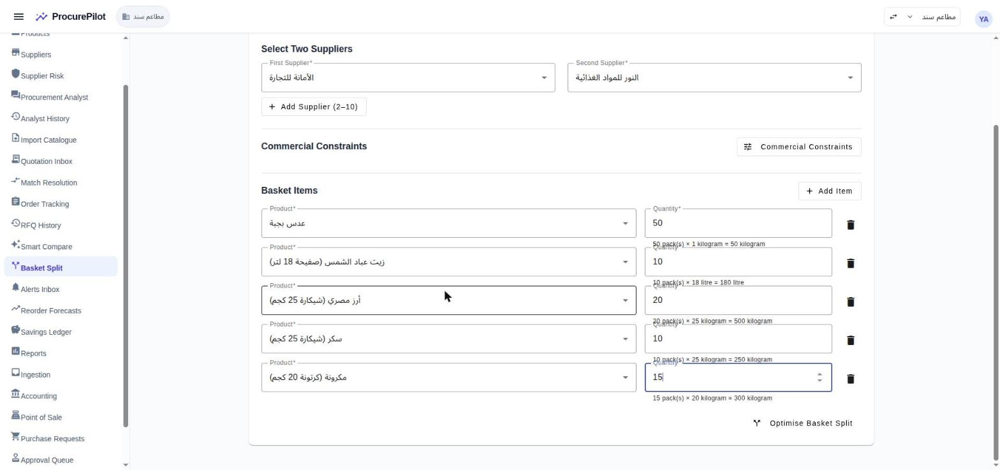

# Round 1 walkthrough — dry goods, «مطاعم سند» (hosted)

The first full purchasing round run through the real product on hosted
(`procurepilot.iron-sys.com`), workspace «مطاعم سند» (EGP, Egypt VAT), as the owner account
`pp-owner`. Dataset and findings: [`../README.md`](../README.md). Video status:
[`../../video/production-tracker.md`](../../video/production-tracker.md).

Screenshots were taken from the live demo tenant on 2026-10-18, after PRs #108–#112 were deployed;
screenshots 02, 03 and 07 were retaken after #128 deployed (quantities without trailing zeros, per-pack PO prices).
They show the product as it is, including the open label issues listed at the end.

## The round in one line

RFQ to 2 suppliers (Oct 16) → both reply by email with Arabic PDF quotes → extracted and authorized →
10 product matches confirmed → compare responses → prepare a request from النور's quote
(EGP 56,425) → submit → approve → draft purchase order PO-000001.

## Steps

### 1. Send the RFQ (Oct 16)

RFQ for 5 dry-goods lines (lentils, sunflower oil 18 L tin, rice 25 kg sack, sugar 25 kg sack,
pasta 20 kg carton) to النور للمواد الغذائية and الأمانة للتجارة, needed by Oct 20. The email goes out in
Arabic, names the buyer and carries the buyer's terms (#89).

### 2. Supplier replies arrive by email

Each supplier replied from Gmail (plus-address aliases, see `../README.md` § Mailboxes) with an
Arabic PDF quote. The email-ingestion worker stores the attachment (Arabic file names, #90), matches
the reply to the RFQ (#84) and queues extraction.

### 3. Extraction, review and authorization

Azure Document Intelligence reads each PDF. Dates in DD/MM/YYYY (#96), right-to-left tables read row by
row (#100). Both quotes needed a human check of a low-confidence supplier name and were then
authorized (#104). Totals reconcile: النور 56,425; الأمانة 56,925 including 250 delivery.

After authorization the quotes no longer appear in the Quotation Inbox (it lists open review tasks
only), so there is no screen listing received quotes — see "Open issues".

### 4. Match products

The 10 quote lines (5 per supplier) were confirmed against the catalogue in Match Resolution.
Exact-name lines can now be confirmed in bulk (#109).

### 5. Compare the responses

`RFQ History → (row) → RFQ Responses` shows each supplier's lines with per-pack prices. النور is
cheaper overall; الأمانة is cheaper on rice, sugar and lentils — the case basket split is for.

### 6. Prepare and submit the purchase request

Choose the branch (فرع المعادي), then **Prepare Request** on النور's card. The draft request carries
the quoted lines, priced per pack, estimated total **EGP 56,425** (#110; before the fix it showed
6,135.58). Choose the cost centre (المطبخ — المعادي) and **Submit Request**.

### 7. Approve

The request is routed to the owner (no approval rule set, so owner fallback). Approve from the
Approval Queue (web). The phone approval is tested separately.

### 8. Create the purchase order

**Create purchase order** pre-fills the supplier (النور), order number (PO-000001), per-pack
quantities and prices and canonical base units (#110, #112). Set the expected delivery date and
create. The PO is a draft until submitted; ProcurePilot never writes back to suppliers or accounting.

## Basket split (run 2026-10-18)

Basket Split with الأمانة and النور, the five lines in packs (lentils 50, oil 10, rice 20, sugar 10,
pasta 15). The optimiser on hosted completed the job (2511bb47) in about 2 seconds:

| Supplier | Lines | Landed cost (EGP) |
|---|---|---|
| الأمانة | rice, sugar | 27,400 |
| النور | lentils, oil, pasta | 28,575 |
| **Split total** | | **55,975** — EGP 450 less than all from النور (56,425) |

**Bug (finding 21):** the result page cannot load it. `GET /api/v1/baskets/{id}` returns 500 because the
optimiser stores a result shape the API's `AdvancedBasketResult` rejects (lines lack `supplier_id`,
`confidence` is an object not high/medium/low, extra `rule_version`/`advisory_only`). Hidden until now
because hosted had no optimiser. Handed to the optimiser session 2026-10-18.

## Savings ledger (checked 2026-10-18)

Empty. Savings are not created from a PO: each purchase is recorded by hand (Savings Ledger → Record
Purchase Outcome, one product line at a time, quantity in base units). The baseline is the
`last_paid` price = the most recent landed cost for the product. With one round, that is the
competing quote of the same RFQ (الأمانة's were recorded last), so recording PO-000001 would give:

| Line (bought from النور) | Baseline = الأمانة quote | Paid | "Saving" |
|---|---|---|---|
| Rice 500 kg | 18,500 | 18,800 | −300 |
| Oil 180 L | 17,250 | 16,800 | +450 |
| Sugar 250 kg | 8,900 | 9,050 | −150 |
| Lentils 50 kg | 3,650 (incl. delivery) | 3,600 | +50 |
| Pasta 300 kg | 8,625 | 8,175 | +450 |

Net +500, depending only on which quote was entered last — not recorded, to keep the demo ledger
honest. Findings:

- **22:** no path from a PO (or its delivery) to a purchase outcome; the buyer re-types each line, in
  base units while the PO is in packs.
- **23:** "last paid" uses quoted landed costs, not prices actually paid, and within one RFQ it picks
  whichever quote was recorded last. Needs a product decision on the baseline (e.g. previous purchase
  of the product, or the median of earlier rounds) before the video's savings number.

Rounds 2–3 give the real history a savings number needs.

## Not yet run in round 1

- Phone approval (mobile build at 390×844).

## Open issues seen on these screens

Fixed by #128 (deployed 2026-10-18; screenshot 7 retaken after the fix):

- PO lines now show the price per pack and per base unit ("EGP 940.00 / pack of 25 kg · EGP 37.60 / kg").
- Quantities show without trailing zeros ("20", not "20.000000").
- The new-request button on Purchase Requests is labelled "New request".
- Basket split with no offers at all shows a plain message instead of a validation error.
- The cost-centre list is filtered to the selected branch.
- New POs no longer append an English "(pack of …)" to Arabic descriptions. PO-000001 was created
  before the fix, so its stored descriptions still carry it.

Not yet raised:

- No screen lists received quotations once their review is done.
- The request page still offers "Create purchase order" after PO-000001 exists.
- "Remaining budget" stays at EGP 380,000 after approving and ordering EGP 56,425.
