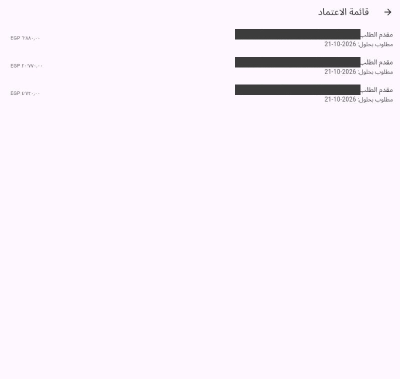
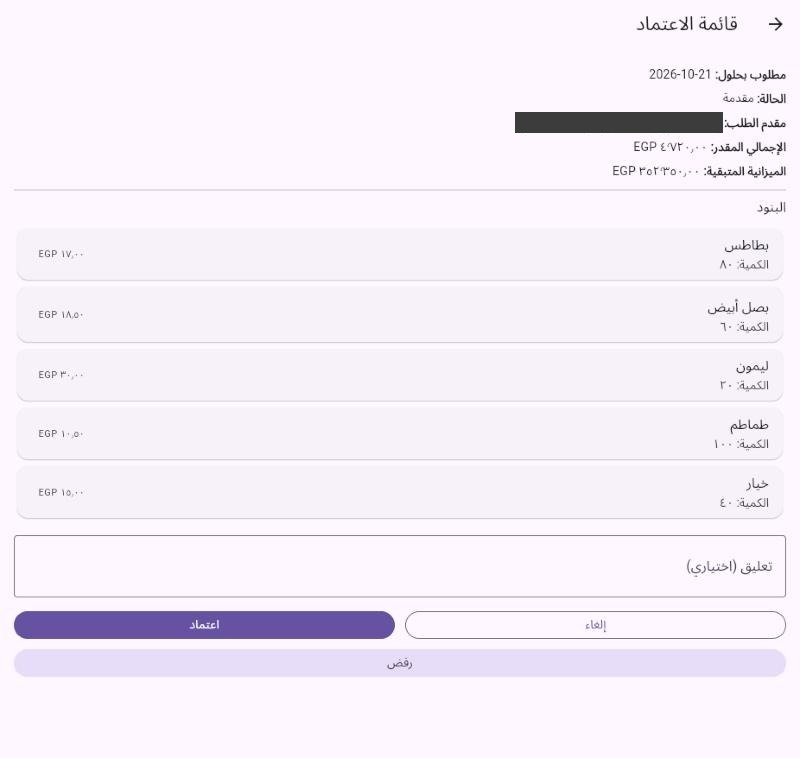
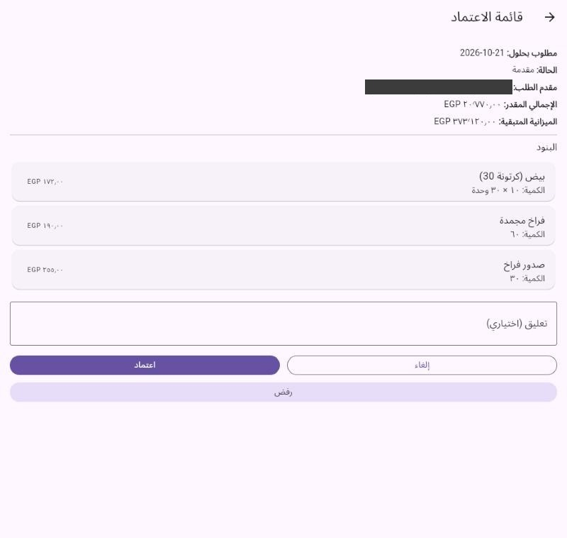
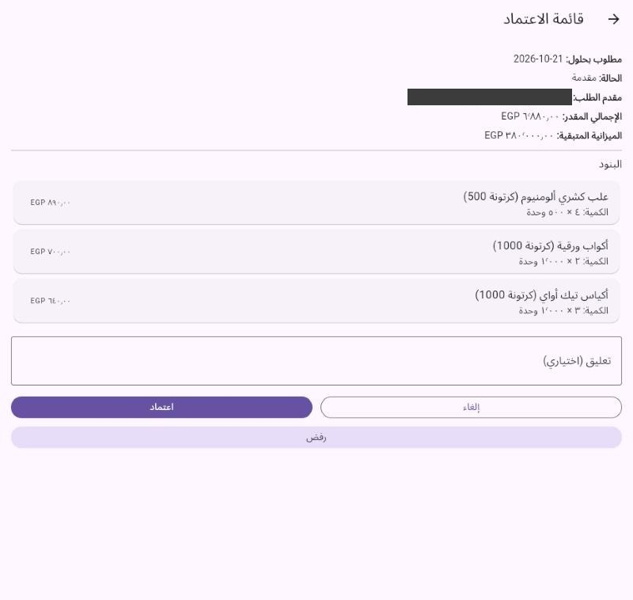
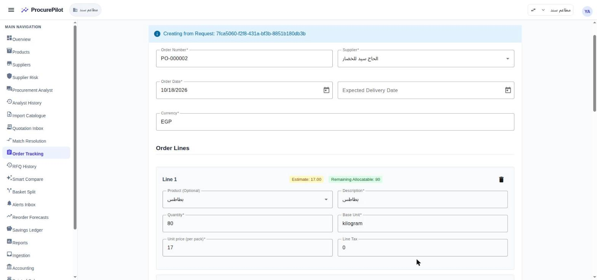
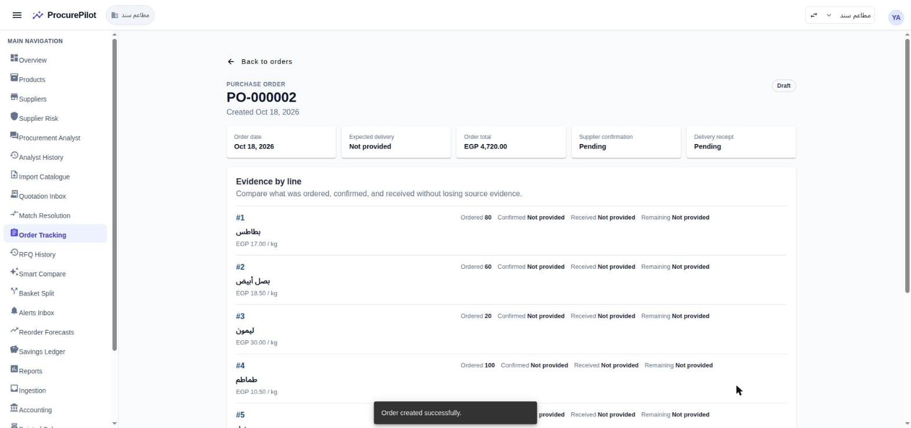
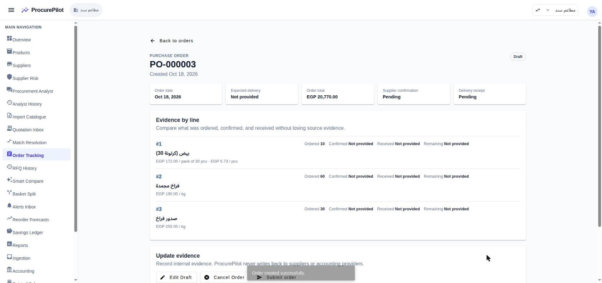

# Rounds 2 and 3 walkthrough — fresh produce, poultry, packaging, «مطاعم سند» (hosted)

The second and third purchasing rounds run through the real product on hosted
(`procurepilot.iron-sys.com`), workspace «مطاعم سند» (EGP), as the owner account `pp-owner`.
Round 1, which shows the RFQ, extraction and compare screens in full, is in
[`../round-1/README.md`](../round-1/README.md); dataset and findings: [`../README.md`](../README.md).

Screenshots were taken on 2026-10-18 after PRs #146–#155 were deployed. Phone screenshots come from the
Flutter app built for the web (`flutter build web`) and run in a browser at phone width; the requester's
email is blacked out.

## The rounds in one line

Three single-supplier RFQs (vegetables → الحاج سيد للخضار, poultry and eggs → دواجن الفيروز,
packaging → باك مصر) → each supplier replies by email with an Arabic PDF quote → extracted and
authorized → 11 exact-name matches confirmed in one action → three requests prepared from the
responses (EGP 4,720 / 20,770 / 6,880) → submitted → approved on the phone → POs PO-000002,
PO-000003 and PO-000004.

## Steps

### 1. RFQs and replies

| RFQ | Supplier | Lines | Quote |
|---|---|---|---|
| `8b9a4886` | الحاج سيد للخضار | potatoes, white onion, lemon, tomatoes, cucumber (kg) | EGP 4,720 |
| `f758090d` | دواجن الفيروز | eggs (carton of 30), frozen chicken, chicken breast (kg) | EGP 20,770 |
| `6bbe01c7` | باك مصر | koshary foil box (carton of 500), paper cups and takeaway bags (cartons of 1,000) | EGP 6,880 |

Replies were sent from the suppliers' plus-address Gmail aliases with the PDF attached. All three quotes
were extracted with every line and total correct, then authorized.

### 2. Matching

All 11 lines matched catalogue products by exact name. "Confirm all exact matches" (#109) confirmed them
in one action; it took about 25 seconds.

### 3. Requests

A request was prepared from each RFQ response, with prices per pack (ADR-020) and the cost centre set:
vegetables and poultry → المطبخ — المعادي, packaging → التغليف والنظافة — المعادي. All three were
submitted.

### 4. Approval on the phone

The owner's approval queue lists the three requests with their totals and required-by date.

The detail screen shows product names, quantities and per-pack prices (#147, #148). After approving, the
screen closes and shows «تم اعتماد الطلب».

Packed products show the pack as "10 × 30 units" (#148). Note the remaining budget: 373,120 here, 380,000
on the packaging request. See finding 24.

### 5. Purchase orders

Create purchase order (from the approved request) opens the form prefilled with the supplier, the next
order number, each line's quantity and the price per pack, and the remaining allocatable quantity.

PO-000003 shows the egg line as "EGP 172.00 / pack of 30 pcs · EGP 5.73 / pcs" (#128).

## Findings from these rounds

Recorded in the findings table of [`../README.md`](../README.md) as 24–29.

- **24 — Remaining budget ignores approved spend.** Approval moves a request straight to `ordered`
  (spec 010), but committed spend counts only `submitted` and `approved` requests. After these approvals
  the Maadi branch still shows the full EGP 380,000 remaining, with about EGP 92,000 ordered.
- **25 — A quote in review with no review task is invisible.** الحاج سيد's quote had no low-confidence
  field, so no review task was created; it is `In Review` but absent from the Quotation Inbox and reachable
  only by link.
- **26 — A refused reply still shows as an RFQ response.** دواجن الفيروز's first reply had no attachment
  and was refused as `email-body.txt`; the RFQ still lists it, with an empty card and an active Prepare Request
  button.
- **27 — Bulk confirm is slow.** 11 exact matches took about 25 seconds.
- **28 — The phone app's web build signs out on reload.** Seen only in the web build used for these
  screenshots; the installed app was not tested.
- **29 — The web app signs out about every hour.** Not yet investigated.
