# Flow review — round-1 steps on «مطاعم رواق» (2026-10-28)

The round-1 flow ([`../../../demo-tenant/round-1/README.md`](../../../demo-tenant/round-1/README.md)) run again
from the start on the hosted Saudi workspace, as `pp-sa-owner`, through Claude in Chrome. English UI. Findings
are recorded here to be handled later; nothing found during this run has been fixed in it. The owner's email is masked in
screenshots 04, 05 and 10.

**Status (2026-10-30):** fixed in [#314](https://github.com/YasserHosny/ProcurePilot/pull/314) and [#315](https://github.com/YasserHosny/ProcurePilot/pull/315) (PPS-88), except R6 and the parts of O3 and O6 marked
open below. R7–R18 come from steps 3–8, basket split and savings, run on 2026-10-30; R13 and R14 are fixed (#348, #350, checked live in [`fixes-pps-118-119/`](fixes-pps-118-119/README.md)), the rest are open. The fixes were checked live on 2026-10-28, with screenshots, in [`fixes-pps-88/`](fixes-pps-88/README.md).

## Steps

### 1. Send the RFQ (2026-10-28)

RFQ `d8f7fb0c` for 4 dry-goods lines, in packs: basmati rice 10 kg ×20, sunflower oil 18 L tin ×10, white sugar
10 kg ×10, flour 45 kg ×15. Sent to الذهبي للتموين (`+pp-sa-dhahabi`) and الوفرة للمواد الغذائية (`+pp-sa-wafra`),
needed by 4 Nov 2026, terms «الأسعار شاملة التوصيل إلى الفرع، والعرض سارٍ 14 يومًا.» Save Draft, then Send RFQ:
"RFQ sent. Suppliers emailed: 2".

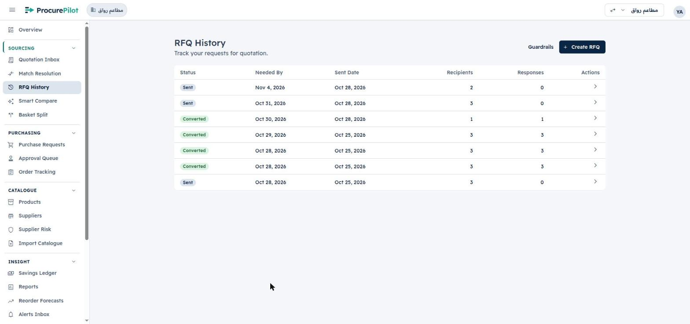

### 2. Supplier replies (2026-10-28, 11:35–11:36)

Quotes from [`../../setup/quotes/gen_quotes_review.py`](../../setup/quotes/gen_quotes_review.py) (SAR, 15% VAT
included, free delivery): الذهبي `DH-26-1241` **4,830.00** (rice 86, oil 150, sugar 38, flour 82 per pack);
الوفرة `WF/2026/0765` **4,855.00** (rice 88, oil 146, sugar 36, flour 85). الوفرة is cheaper on oil and sugar, so
a basket split should come to 4,770 (60 below all-الذهبي). Each was sent from Gmail as a reply to its own RFQ
message, from the supplier's send-as alias to `mtaam-rwaq@mail.procurepilot.iron-sys.com`, body «مرفق عرض السعر
المطلوب.», PDF attached. (Arabic typed into the Gmail body this time.)

Within about a minute both replies were ingested, matched to the RFQ (RFQ History: «Responded», 1 response at
first) and extracted. The Quotation Inbox lists both with the right supplier and stated total, reason «Low
Confidence Extraction»: الوفرة `70ad704c` SAR 4,855, الذهبي `2e7861de` SAR 4,830.

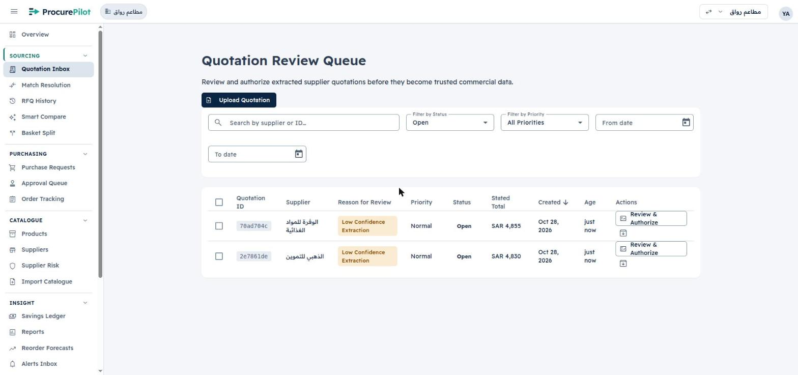

### 3. Review and authorize (2026-10-30)

Both quotes opened with «Arithmetic Verified» (stated total = computed lines total: الذهبي SAR 4,830, الوفرة
SAR 4,855) and one flagged field each, the expiry date (57% / 56% confidence), read correctly as 07/11/2026 and
08/11/2026 («Valid for 8 days» / «9 days»). Supplier, currency (SAR), issue date and all four lines with their
quantities, per-pack prices and line totals matched the PDFs. Each: **Confirm as-is** on the expiry date, then
**Confirm & Authorize Quotation** → **Confirm & Authorize**. Both now show «Reviewed & Authorized» with a «Next
step: Match lines» banner (new since #325).

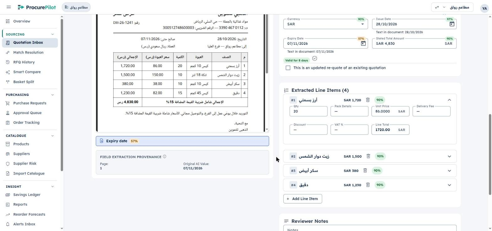

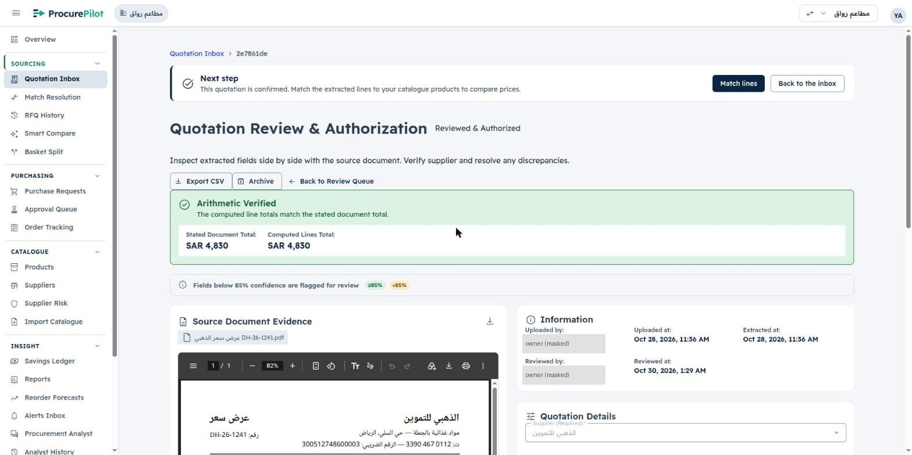

### 4. Match products (2026-10-30)

Nothing to do by hand: all 8 lines were auto-matched to the right catalogue product at **97%** when the quotes
were authorized (round 1 on «مطاعم سند», 2026-10-17, needed all 10 lines confirmed by hand at 55%). The «Match
lines» button on an authorized quote opens Match Resolution filtered to that quote; with the default status
filter («Awaiting Match Decision») it says «All lines of this quote are matched» and offers **Compare responses**.
Choosing «All Statuses» lists each line, its top candidate and «Auto-matched». Lines are listed last-first (#4 → #1).

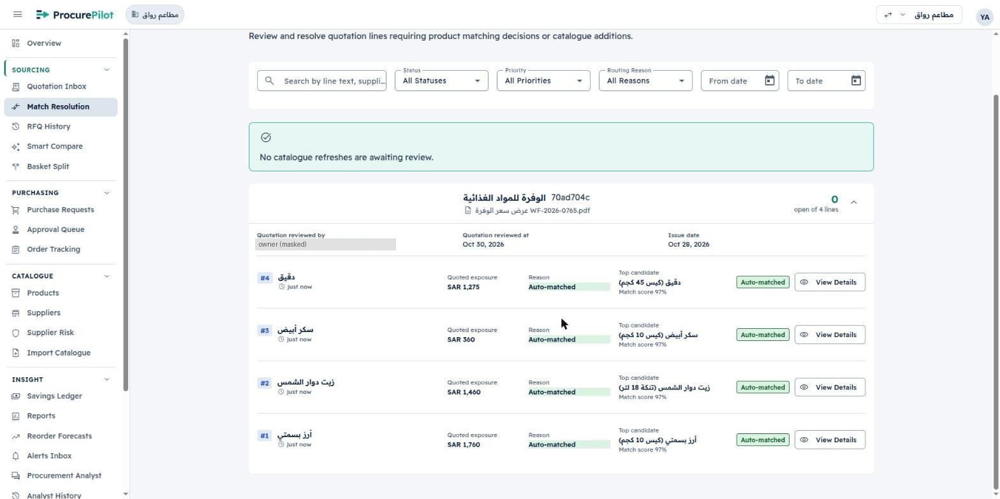

### 5. Compare the responses (2026-10-30)

RFQ History now shows the RFQ as **Converted** (2 recipients, 2 responses, sent «Oct 28, 2026 · 11:09 AM»). The
Responses link opens the new **RFQ Details** page (#322/#325): breadcrumbs «RFQ History › RFQ · Sent Oct 28, 2026 ·
11:09 AM», tabs Details / Items / Recipients (2) / Responses (2). Each supplier's card lists the four lines with
quantity, per-pack price and line total; الذهبي carries «Lowest total» (SAR 4,830 vs 4,855). The lines still read
flour first: this RFQ was saved before the R2 fix, so its stored lines keep the old order.

Authorizing الذهبي's quote fired the guardrail (limit SAR 10,000): «Guardrail fired and prepared a draft
request.» Purchase Requests has it: needed by Nov 4, فرع العليا, الذهبي للتموين, **Draft · Auto-prepared, SAR
4,830**. That is round 1's step 6 (Prepare Request on the cheapest card) done automatically.

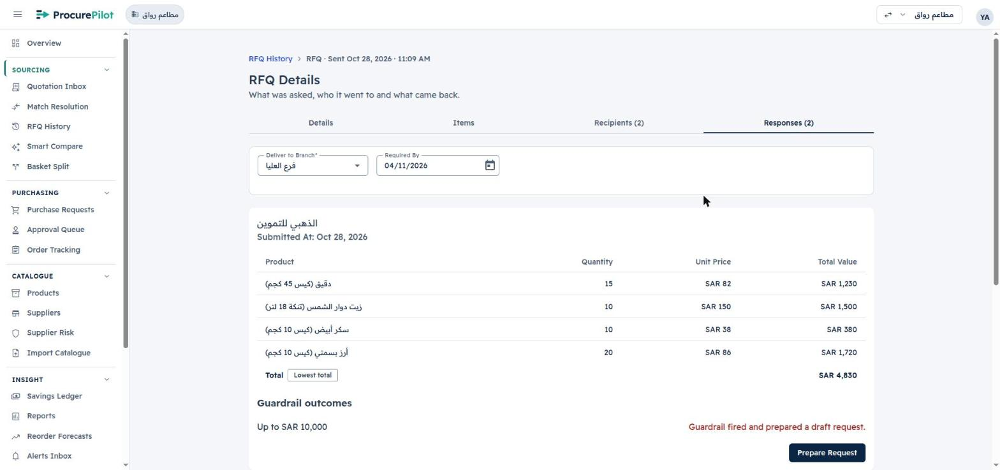

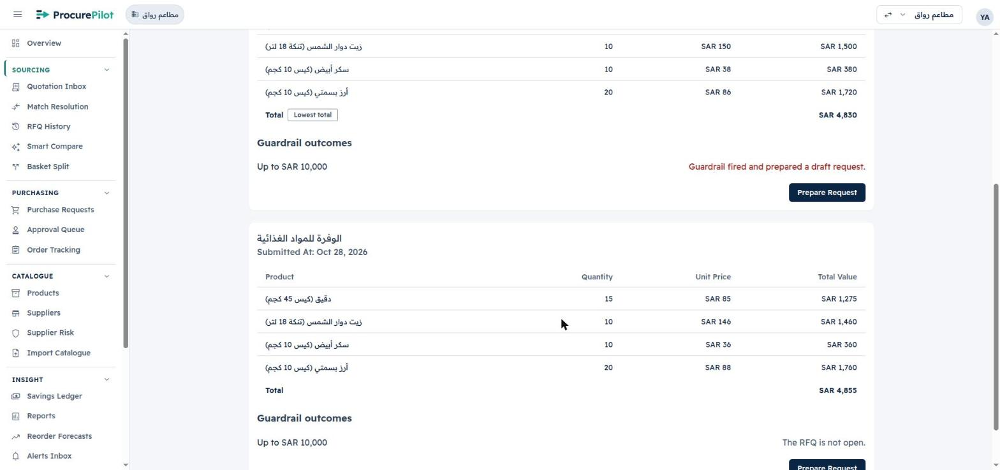

### 6. Submit the purchase request (2026-10-30)

The guardrail's draft (Purchase Requests → view) opens as **Edit Purchase Request**, «From RFQ · الذهبي للتموين ·
quote» (both links), with the banner «Prepared automatically by a guardrail … nothing is ordered until it is
approved.» Everything was already filled in correctly: branch فرع العليا, cost centre المطبخ — العليا (the guardrail's
default), required by 04/11/2026, the four lines in packs at الذهبي's per-pack prices (flour 15 × 82, oil 10 × 150,
sugar 10 × 38, rice 20 × 86), estimated total **SAR 4,830**. **Submit Request** → «Purchase request submitted for
approval.»; the list shows it **Submitted · Auto-prepared, SAR 4,830**.

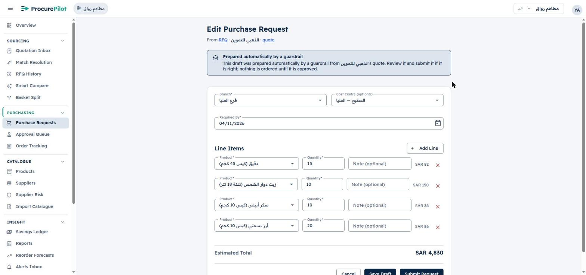

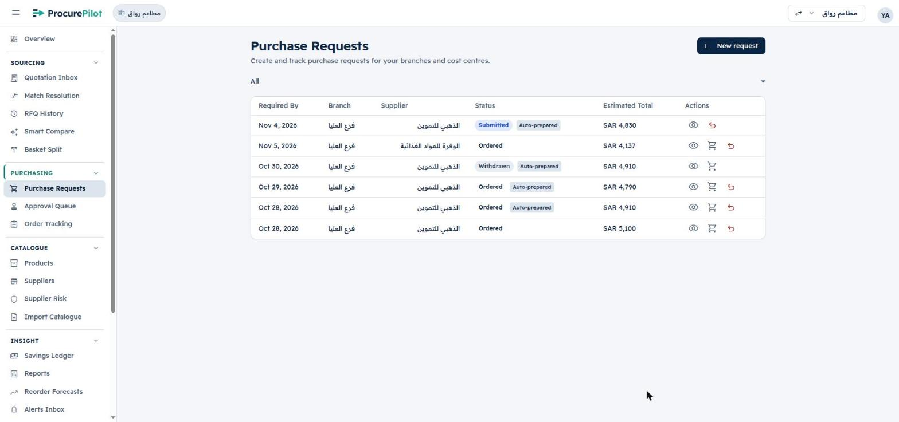

### 7. Approve (2026-10-30, web)

No approval rule is set, so the request went to the owner. Approval Queue: required by Nov 4, فرع العليا, المطبخ —
العليا, الذهبي للتموين, SAR 4,830, budget «No budget configured / No budget at cost-centre level» (the Saudi
workspace has no budgets set up), «4 lines» expanding to the four lines at the quoted per-pack prices. **Approve** →
dialog «Approve SAR 4,830 for فرع العليا?» with an optional comment → **Confirm** → «Request approved.» with a
**Create purchase order** action in the toast; the queue is empty. The Approve / Reject buttons sit under the Lines
column with Actions empty on the hosted build used here; #329 (PPS-102, merged) moves them into Actions. The phone approval was not run.

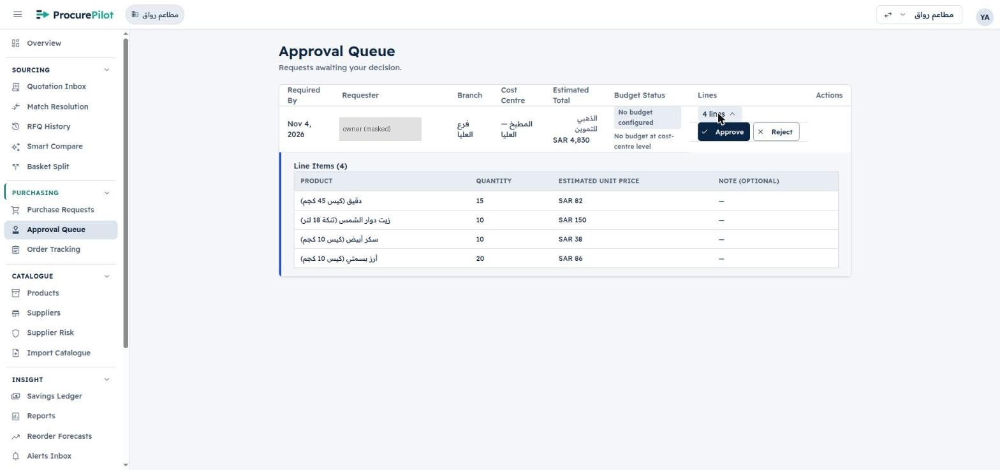

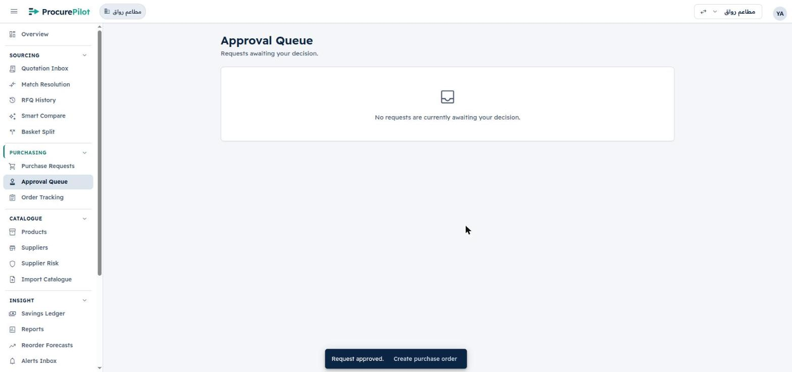

### 8. Create the purchase order (2026-10-30)

After approval the request reads **Ordered**. **Create purchase order** opens «Create Purchase Order — Check the
order, then create it.», «From an approved request — الذهبي للتموين, فرع العليا», pre-filled: order number
**PO-000005**, supplier الذهبي, order date 30/10/2026, expected delivery 04/11/2026 (the request's required-by
date), SAR, and four lines with product, Arabic description, pack quantity, base unit (kilogram / litre), price per
pack («pack of 45 kg»), an «Estimate» and «Still to order» chip, line tax 0; lines total and order total **SAR
4,830**. Nothing needed changing. **Create Purchase Order** → «Order created successfully.» — but the page stays on
the form (R13). Order Tracking lists PO-000005 once: Draft, 4 lines, SAR 4,830. The PO page shows per-pack and
per-base-unit prices («SAR 150 / pack of 18 L · SAR 8.33 / L»), supplier confirmation and delivery receipt
«Pending», and Edit Draft / Cancel Order / Submit order. The PO stays a draft; ProcurePilot never writes back to
suppliers or accounting.

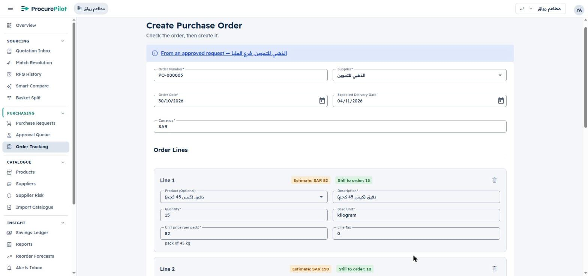

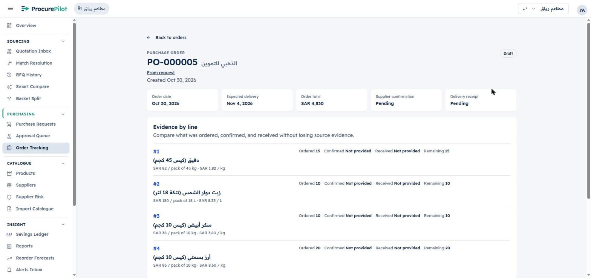

## Basket split (2026-10-30)

Basket Split opens with الذهبي and الوفرة already chosen and one item (rice ×10). The RFQ's four lines had to be
entered again by hand: rice 20, oil 10, sugar 10, flour 15 (packs; each row shows «20 pack(s) × 10 kg = 200 kg»).
**Optimise Basket Split** → result in a few seconds, «Optimisation Completed · Solver Confidence: High»:

| Supplier | Lines | Landed cost (SAR) |
|---|---|---|
| الوفرة | oil 10 × 18 L, sugar 10 × 10 kg | 1,820 |
| الذهبي | rice 20 × 10 kg, flour 15 × 45 kg | 2,950 |
| **Split total** | | **4,770**: «Splitting saves SAR 60 versus buying exclusively from الذهبي للتموين.» |

That is exactly the split the quotes were priced for (job `f7e301c9`). The result page offers only Rerun
Optimisation and Start New Basket Split: nothing turns the split into requests or orders (R16). PO-000005 already
buys everything from الذهبي, so the split was not acted on.

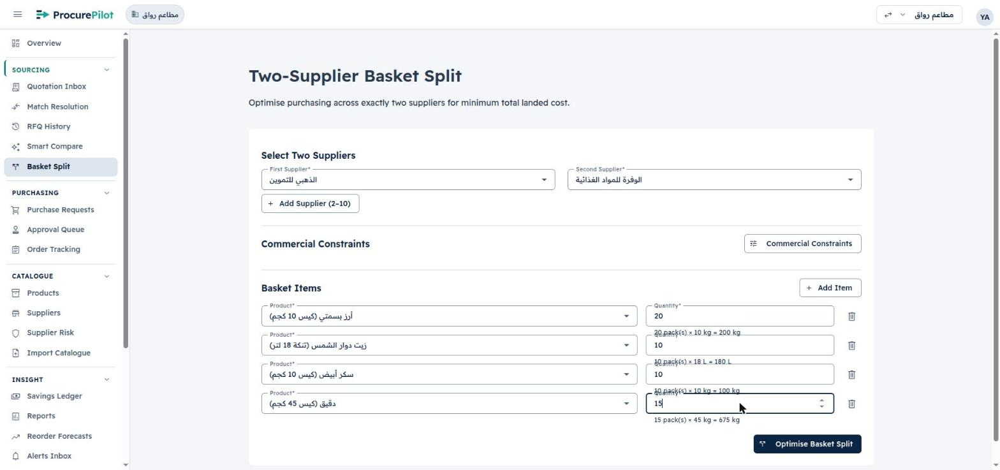

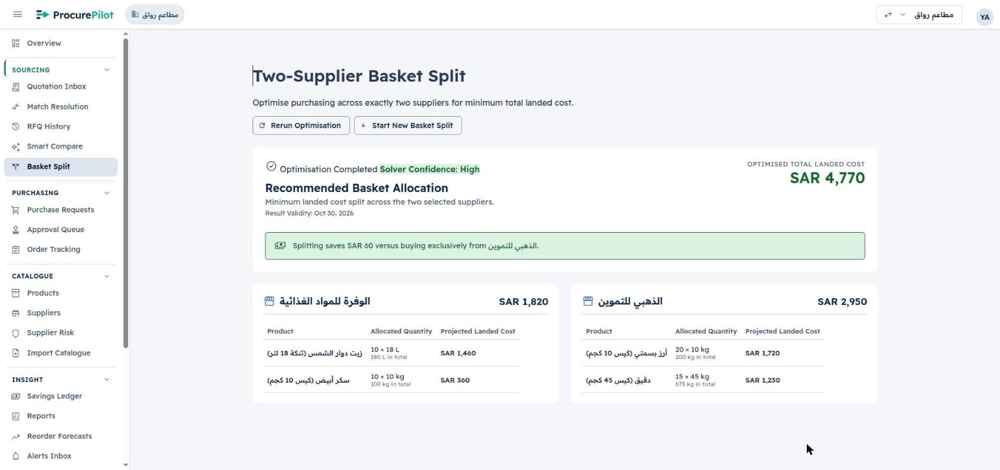

## Savings (2026-10-30)

PO-000005 → **Submit order** (status Submitted; nothing is sent to the supplier) → **Record outcome**: «One line per
order line, converted from packs to base units», baseline «the last purchase-order price for each product,
excluding this order … fall back to the last quoted price». Pre-filled 675 kg / 180 L / 100 kg / 200 kg and totals
1,230 / 1,500 / 380 / 1,720, all four ticked. **Save 4 outcomes** → «4 purchase outcomes recorded.», Savings Ledger:

| Line | Baseline | Paid (SAR) | Saving |
|---|---|---|---|
| Rice 200 kg | 1,740 — Last PO Price (87/pack, round E's PO-000003) | 1,720 | +20 |
| Oil 180 L | 1,480 — Last PO Price (148/pack, PO-000003) | 1,500 | −20 |
| Sugar 100 kg | 360 — Last Quoted Price (الوفرة's 36 in this RFQ) | 380 | −20 |
| Flour 675 kg | 1,275.01 — Last Quoted Price (الوفرة's 85 in this RFQ) | 1,230 | +45.01 |

Net +25.01, all four «Pending · Calculated, not yet verified»; the verified total stays SAR 310 (9 verified, 4
pending). Sugar and flour were never bought before, so their baseline is the competing quote in the same RFQ: the
saving says whether الذهبي beat الوفرة on that line, not whether the price fell. That follows the owner's 2026-10-18
baseline decision (last PO price, then last quoted price); it reads oddly on a first purchase. Verifying the
outcomes was not done in this run.

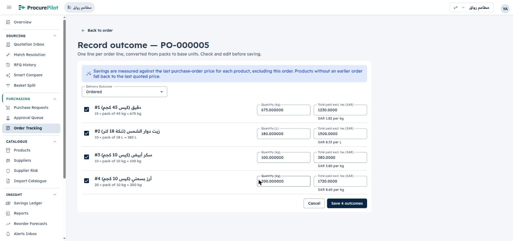

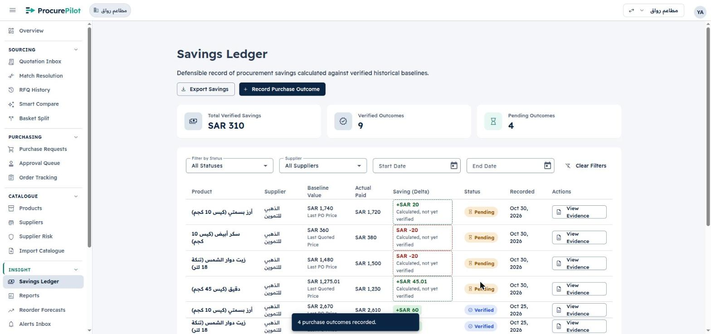

## Findings

Checked against the code by a side review on 2026-10-28 (file references are as of `ae2e8e67`).

| # | Where | Finding | Impact / fix | Status |
|---|---|---|---|---|
| R1 | Create RFQ | After picking a product, the first click on that line's Quantity field does nothing; a second click works. The app code does nothing odd here (plain `mat-select` + `matInput`, `create.component.html:40,50`); most likely Material's closing overlay backdrop takes the click, which fast automated clicks hit more often | confirm by hand; if real, focus the line's Quantity on `selectionChange` | **Fixed** ([#314](https://github.com/YasserHosny/ProcurePilot/pull/314)): reproduced by hand with fast clicks; the product field is now a search box with no backdrop, and a pick moves focus to Quantity |
| R2 | RFQ save (API) | Saved RFQ lines come back in an undefined order: entered rice, oil, sugar, flour; the draft and the RFQ email show flour, oil, sugar, rice. Cause is the backend, not the form: every line of one save gets the same `created_at` (`now()` = transaction start, migration `20260924203650_rfq_sourcing.sql:25`), reads `order by created_at` (`modules/rfq/service.py:83,195`), update deletes and re-inserts all lines (`:229–250`), and the send query has no ORDER BY (`:297`) | the buyer's order is lost on screen and in the supplier email; fix with a `position` column written on save and used in every read and the send | **Fixed** ([#314](https://github.com/YasserHosny/ProcurePilot/pull/314)): `rfq_line.position` written on save, used by every read and the email; RFQs saved earlier keep their stored order |
| R3 | Create RFQ | The Terms and Conditions textarea has no `dir="auto"` (`create.component.html:87`), so Arabic terms sit left-aligned in the English UI | Arabic terms read awkwardly | **Fixed** ([#314](https://github.com/YasserHosny/ProcurePilot/pull/314)) |
| R4 | Suppliers, RFQ supplier picker | Neither the supplier list (`supplier-list.component.ts:69`, name cell `.html:85–92`) nor the RFQ supplier picker (`create.component.html:68`) shows the supplier's email, so the buyer cannot check where an RFQ will go | wrong-address sends go unnoticed | **Fixed** ([#314](https://github.com/YasserHosny/ProcurePilot/pull/314), [#315](https://github.com/YasserHosny/ProcurePilot/pull/315)) |
| R5 | Create RFQ | The product picker has no search: it is a plain `mat-select` (`create.component.html:40–46`) whose typeahead only jumps to the first option starting with the typed text, and never filters. With a large catalogue the buyer scrolls | slow product pick; needs `mat-autocomplete` or an in-panel search field | **Fixed** ([#314](https://github.com/YasserHosny/ProcurePilot/pull/314)): search filters as you type, Arabic-aware, over every product page |
| R6 | RFQ email | The RFQ email went out in **English** although the workspace default is AR. Intended since #166 (2026-10-18): the email locale is `coalesce(sender's preferred_locale, tenant default_locale)` (`modules/rfq/service.py:300–306`). Since #310 (PPS-86, 2026-10-27) the language picked before sign-in is saved on sign-in, so the owner's English sign-in set `preferred_locale = en`. In the same Gmail inbox, today's 08:07 RFQ email (needed by 30 Oct) was Arabic and the 10:25 and 11:09 ones are English | not a regression; product decision: should supplier emails follow the buyer's UI language, the workspace default, or a per-supplier language? | **Open**: owner decision |
| R7 | Quote review → Confirm & Authorize | After the final **Confirm & Authorize** the page keeps showing «In Review» and the authorize buttons for about 5 s with no busy indicator, then updates. I reloaded الذهبي's page at ~4 s thinking nothing had happened | a buyer may click again or leave believing it failed | **Open**: fix scheduled as PPS-120 |
| R8 | Quote review, line items | Unit price shows four decimals («86.0000 SAR») next to line totals with two («1720.00») | raw number formatting on a money field | **Open**: fix scheduled as PPS-121 |
| R9 | Quote review, line items | VAT % stays empty on every line although the quote's total row says «الإجمالي شامل ضريبة القيمة المضافة 15%»; Pack Details is empty although the quote has an «العبوة» column (#327, merged, adds the «العبوة» pack column; these quotes were extracted before it reached hosted) | VAT-inclusive pricing is not recorded per line | **Open**: fix scheduled as PPS-122 |
| R10 | RFQ Details → Responses | Only the total is compared («Lowest total» on الذهبي). Nothing shows that الوفرة is cheaper on oil (146 vs 150) and sugar (36 vs 38), so the case for a basket split (SAR 4,770, 60 less) is invisible on the screen where the buyer compares | the buyer misses a split saving unless they open Basket Split | **Open**: fix scheduled as PPS-123 |
| R11 | RFQ Details → Responses, guardrail outcomes | الذهبي: «Guardrail fired and prepared a draft request.» is in red (error colour), has no link to the draft, and **Prepare Request** stays active, so a second request for the same quote is one click away. الوفرة: «The RFQ is not open.» with an active **Prepare Request** too; the text does not say why (the guardrail already converted the RFQ) | confusing outcome text; risk of a duplicate request | **Open**: fix scheduled as PPS-124 |
| R12 | Approval Queue | The Requester column shows the account email (the owner's Gmail plus-address), not the person's name; the long address also squeezes the Branch and Cost Centre columns into two-line cells | approvers read an email address instead of a name | **Open**: fix scheduled as PPS-125 |
| R13 | Create Purchase Order | After **Create Purchase Order** the toast says «Order created successfully.» but the page stays on the filled form with the button still active (checked for 9 s); a second click would create a second PO for the same request. Order Tracking shows the PO was created once | risk of duplicate purchase orders; the buyer has to find the PO by hand | **Fixed** ([#348](https://github.com/YasserHosny/ProcurePilot/pull/348), [#350](https://github.com/YasserHosny/ProcurePilot/pull/350)). Cause: a frontend deploy landed while the form was open, and the old build's chunk for the PO page was gone, so the navigation failed silently. Now the app reloads the page in full, the button stays disabled after success, and the API already refused the duplicate (409). Checked live in [`fixes-pps-118-119/`](fixes-pps-118-119/README.md) |
| R14 | Purchase request (ordered) | The request page still offers **Create purchase order** after PO-000005 covers every line (all «Still to order» quantities used). Same as round 1's open issue on «مطاعم سند» | a second PO for the same request is one click away | **Fixed** ([#348](https://github.com/YasserHosny/ProcurePilot/pull/348)): the button shows only while a line has quantity left; the request links its PO(s); checked live in [`fixes-pps-118-119/`](fixes-pps-118-119/README.md) |
| R15 | Basket Split input | Each new item defaults to the first product with quantity 10 (rice ×10 again), so a careless run optimises a duplicate line; the «N pack(s) × … = …» hint under each quantity overlaps the next row's Quantity label | duplicate lines; cramped, overlapping text | **Open**: fix scheduled as PPS-126 |
| R16 | Basket Split | No link to the RFQ: the basket cannot be started from an RFQ's responses, so its lines are retyped, and the result has no action to prepare requests or orders from the split (only Rerun / Start New). Spec 024 «RFQ basket split» (PPS-96) is aimed at this: Phase 2 merged in #330 (request groups, one preparation lock per RFQ); starting a split from RFQ responses and preparing requests from the result are still to come | the SAR 60 saving stays on screen; acting on it means rebuilding two requests by hand | **Open**: fix scheduled as PPS-127 |
| R17 | Record outcome | Quantities show six decimals («675.000000») and totals four («1230.0000»); the total field is labelled «Total paid excl. tax» although the quote's prices include 15% VAT (see R9), so the ledger records VAT-inclusive amounts as excl. tax | raw number formatting; VAT basis of every saving is mislabelled | **Open**: fix scheduled as PPS-128 |
| R18 | Savings Ledger | Flour's baseline is SAR 1,275.01, not 1,275.00 (الوفرة 85 × 15): the per-pack price is converted to a per-kg price (85 / 45), rounded, and multiplied back by 675 kg, leaving a 0.01 artefact and a «+SAR 45.01» saving | savings figures carry rounding noise from the base-unit conversion | **Open**: fix scheduled as PPS-129 |

## Owner-requested changes — RFQ History and RFQ page (2026-10-28)

From the owner's annotated screens (numbers on the images match O1–O6). Web paths are under `apps/web/src/app/`,
API paths under `apps/api/src/procurepilot_api/modules/rfq/`.

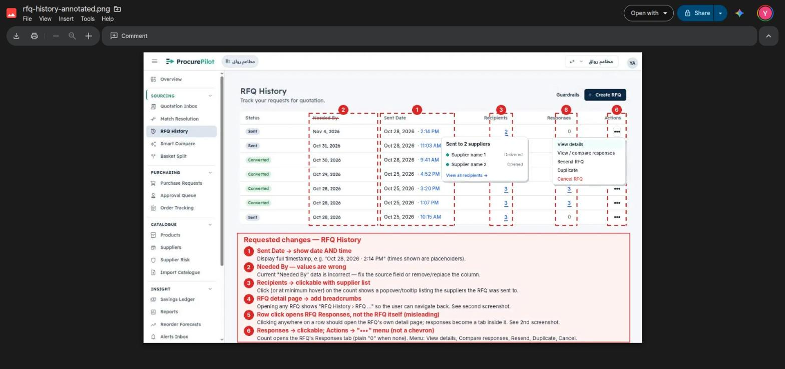

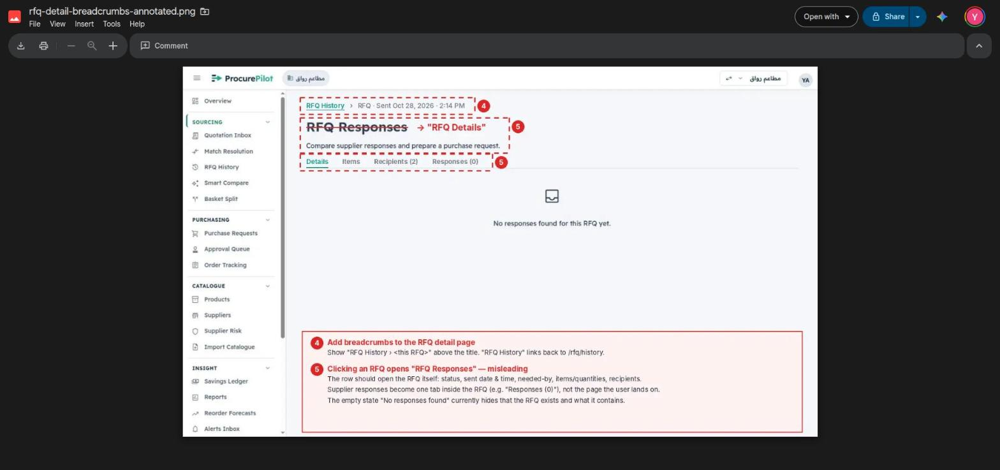

| # | Change | Where | Data available today | Status |
|---|---|---|---|---|
| O1 | RFQ History "Sent Date" shows date **and time** ("Oct 28, 2026 · 2:14 PM") | `rfq/history/history.component.html:57` (time style on `formatDate`) | yes, `sent_at` is a timestamp (`service.py:963`); web only | **Fixed** ([#314](https://github.com/YasserHosny/ProcurePilot/pull/314)) |
| O2 | "Needed By" values look wrong | not a code bug: the column shows `needed_by_date` correctly (d8f7fb0c, entered 04/11, shows Nov 4). The Oct 25 rounds were recorded with hard-coded dates (`docs/gtm/video/source/record-v24/s1-rfq.cjs:6` → 28/10, `rfq-one.cjs:6` → 30/10), hence needed-by 1–3 days after the send. Fix the recording scripts (date from the send day). Separate latent bug: `core/format/format.service.ts:247` parses date-only strings as UTC midnight, so viewers west of UTC see the day before | — | **Fixed** ([#314](https://github.com/YasserHosny/ProcurePilot/pull/314)): scripts default to the send day + 7; date-only strings format as local dates |
| O3 | Recipients count clickable/hover: suppliers it went to, with delivery status | `history.component.html:65–69` | partly: `GET /rfq/{id}` has recipients with `draft/sent/failed` and `sent_at`, but only `supplier_id` (no name). **No Delivered/Opened tracking exists**: needs mail-provider webhooks, new columns and statuses | **Partly fixed** ([#314](https://github.com/YasserHosny/ProcurePilot/pull/314), [#315](https://github.com/YasserHosny/ProcurePilot/pull/315)): popover with sent / failed / not sent and the time. Delivered / Opened tracking is **open** |
| O4 | Breadcrumbs on the RFQ page: "RFQ History › RFQ · Sent <date time>" | `rfq/compare/compare.component.html:4` (or the new detail page); pattern in `quotations/quotation-review/quotation-review.component.html:10–13`; new i18n keys | yes | **Fixed** ([#314](https://github.com/YasserHosny/ProcurePilot/pull/314)) |
| O5 | A row opens the RFQ itself ("RFQ Details": status, sent date/time, needed-by, items, recipients) with tabs Details / Items / Recipients (n) / Responses (n), not "RFQ Responses" | rows route to `/rfq/compare/:id` (`history.component.ts:97–106`); add `rfq/:id` in `app.routes.ts:313` and a tabbed detail component reusing compare as the Responses tab | yes: `GET /rfq/{id}` (`RfqDetail`) and `GET /rfq/{id}/responses`; product and supplier names need resolving (lines carry only ids) | **Fixed** ([#314](https://github.com/YasserHosny/ProcurePilot/pull/314)) |
| O6 | Responses count links to the Responses tab (plain "0" when none); Actions chevron → "•••" menu: View details, Compare responses, Resend, Duplicate, Cancel RFQ | `history.component.html:73–77`, `:80–110` (`mat-menu`) | count yes (`service.py:966–971`); View/Compare web only. **No Cancel, Resend or Duplicate API**: no `cancelled` status (migration), send only emails draft recipients, duplicate could pre-fill create from `getRfq` | **Partly fixed** ([#314](https://github.com/YasserHosny/ProcurePilot/pull/314)): responses link; menu with View details, Compare responses, Duplicate. Resend and Cancel are **open** |
