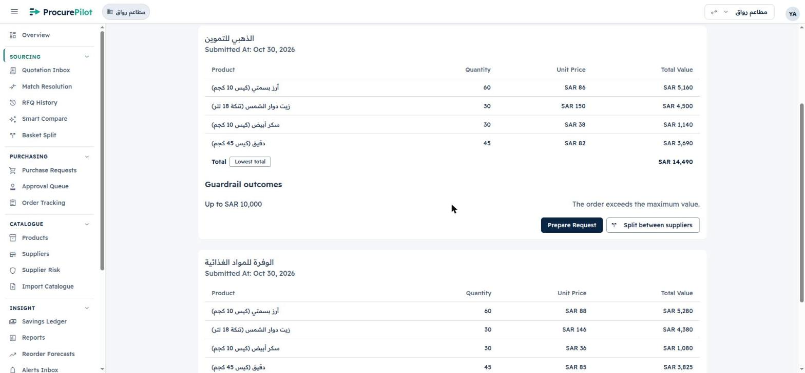
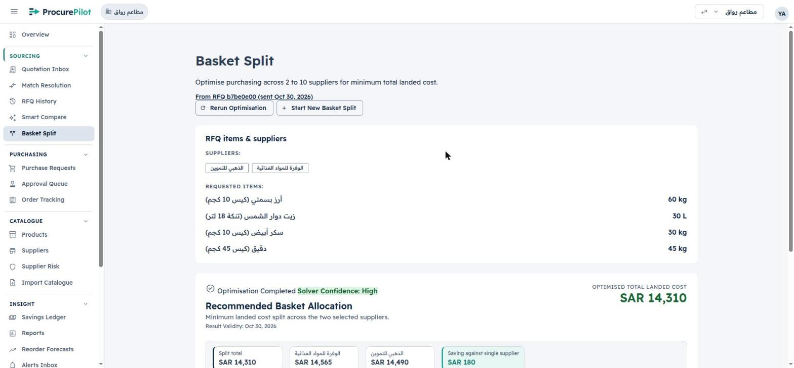
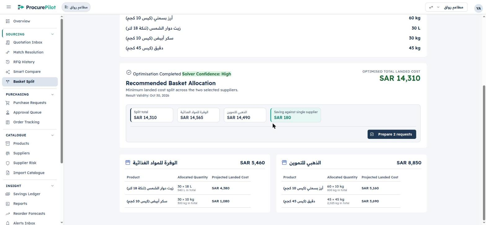
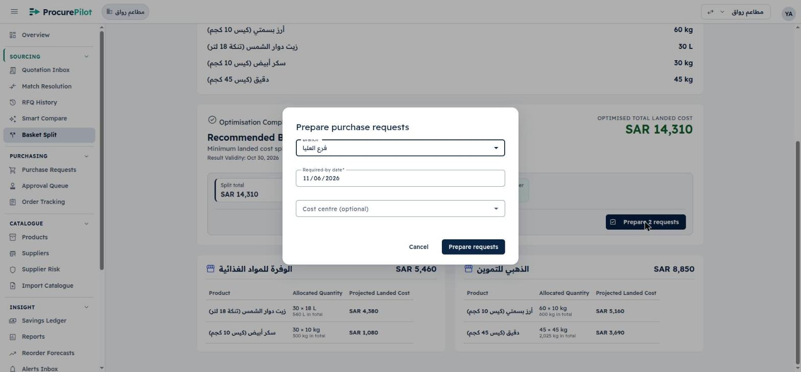
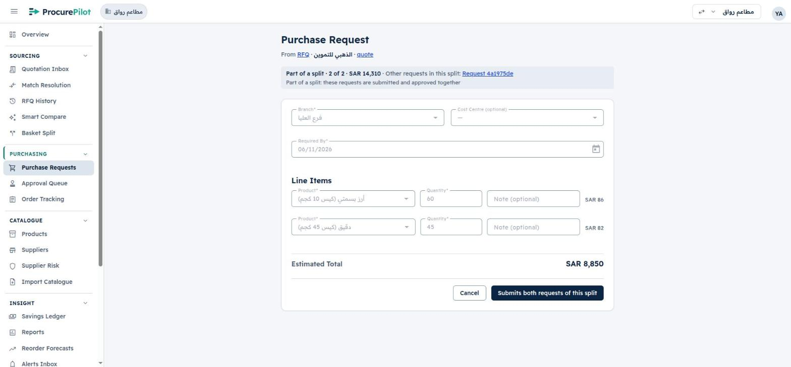
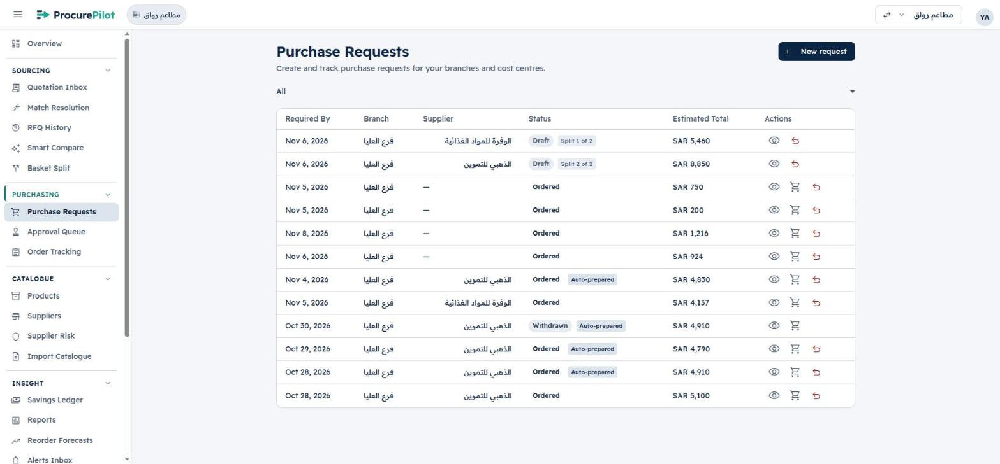
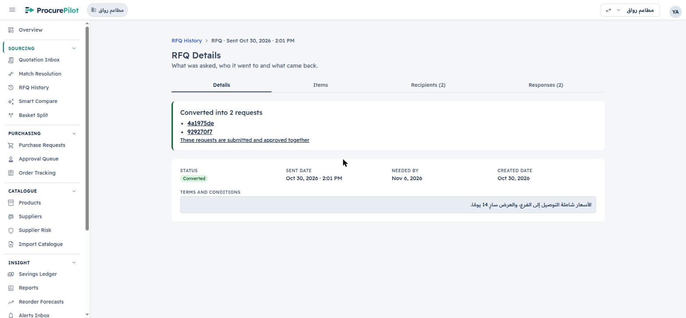
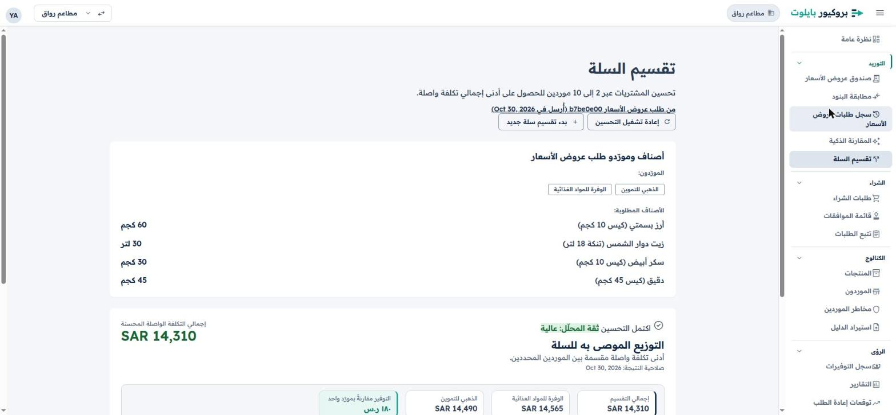
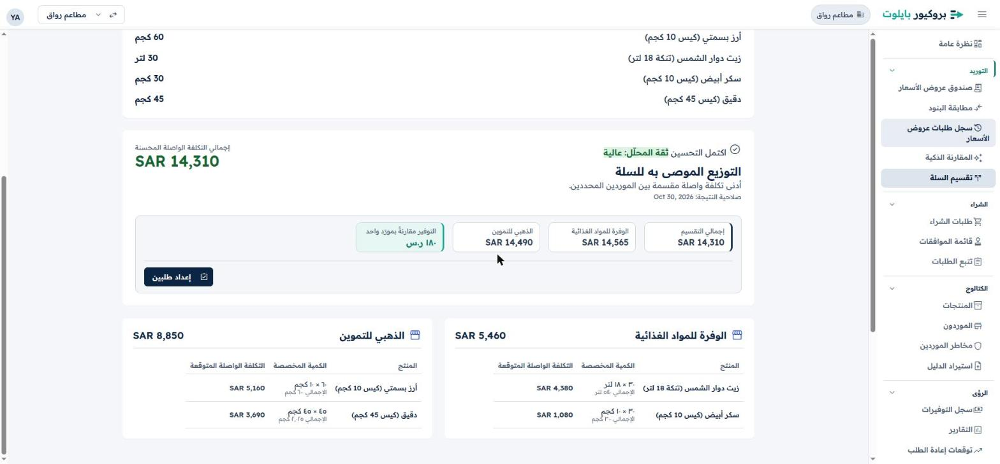
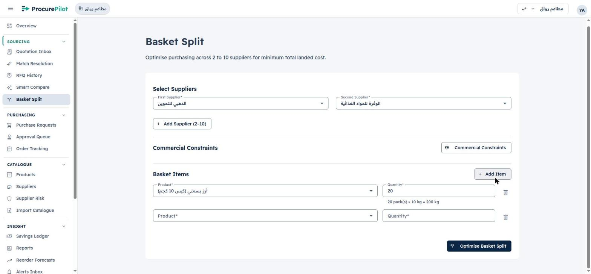

# Flow review 2026-10-28 — Basket Split from an RFQ, checked live (PPS-126, PPS-127)

R15 and R16 from the [flow review](../README.md#findings), driven on hosted «مطاعم رواق» as `pp-sa-owner` through
Claude in Chrome on 2026-10-30. English UI, plus Arabic for the RTL screenshots (switched back afterwards). No
email addresses are visible in these screenshots.

Most of R16 had already been built under spec 024 (PPS-96) and deployed the same morning. The live run found three
gaps in that build, fixed in the PPS-127 PR:

| PR | What | Spec 024 task |
|---|---|---|
| [#341](https://github.com/YasserHosny/ProcurePilot/pull/341) | «Split between suppliers» on RFQ Details → Responses; Basket Split in RFQ mode, priced only from the replies | T009–T016 |
| [#346](https://github.com/YasserHosny/ProcurePilot/pull/346) | `POST /baskets/{id}/prepare-requests`: one draft request per supplier in a request group, under the RFQ preparation lock; RFQ Details «Converted into N requests» | T017–T021, T023 |
| [#349](https://github.com/YasserHosny/ProcurePilot/pull/349) | «Prepare N requests» dialog and summary on the result | T022 |
| [#344](https://github.com/YasserHosny/ProcurePilot/pull/344) | standalone Basket Split: empty new rows, pack hint in flow (R15, part 1) | T032 |
| [#356](https://github.com/YasserHosny/ProcurePilot/pull/356) | standalone Basket Split: «Choose a product» placeholder, no product twice (R15, part 2) | PPS-126 |
| PPS-127 PR | RFQ mode lists the requested items in packs; «Prepare» disappears once the RFQ is converted; the dialog's date reads DD/MM/YYYY | PPS-127 |

## The run

1. **A fresh RFQ** `b7be0e00`, the round-1 lines at three times the quantity (in packs): basmati rice 10 kg ×60,
   sunflower oil 18 L ×30, white sugar 10 kg ×30, flour 45 kg ×45, to الذهبي and الوفرة, needed by 6 Nov 2026.
   «RFQ sent. Suppliers emailed: 2». The quantities are tripled so that each reply is over SAR 10,000. The
   workspace's auto-preparation guardrail (limit SAR 10,000, one response) would otherwise turn the first
   authorized reply into a single-supplier request, convert the RFQ and so block the split (see the note
   below).
2. **Two supplier replies** from Gmail, each a reply to its own RFQ email from the supplier's send-as alias, body
   «مرفق عرض السعر المطلوب.», PDF from
   [`gen_quotes_review.py`](../../../setup/quotes/gen_quotes_review.py)` <dir> 30/10/2026 3 -B`: الذهبي
   `DH-26-1241-B` **SAR 14,490**, الوفرة `WF/2026/0765-B` **SAR 14,565** (same per-pack prices as round 1).
   Both were ingested within a minute.
3. **Review and authorize** both quotes: «Arithmetic Verified», lines as in the PDFs, the expiry date confirmed
   as-is. Lines auto-matched.
4. **RFQ Details → Responses**: الذهبي «Lowest total» SAR 14,490. Guardrail outcome «The order exceeds the maximum
   value.» on both, so the RFQ stays open. **Split between suppliers** is enabled.

   

5. **Split between suppliers** opens `/offers/basket-split/0c55414d…` in RFQ mode: «From RFQ b7be0e00 (sent Oct
   30, 2026)», the two suppliers and the four lines read-only. Result in a few seconds: **SAR 14,310**, against
   الوفرة 14,565 and الذهبي 14,490, **saving SAR 180**. الوفرة gets oil 30 × 18 L (4,380) and sugar 30 × 10 kg
   (1,080) = 5,460; الذهبي gets rice 60 × 10 kg (5,160) and flour 45 × 45 kg (3,690) = 8,850. That is the split the
   quotes were priced for.

   

   

6. **Prepare 2 requests**: the dialog fills the branch (فرع العليا) and the required-by date from the RFQ (6 Nov);
   the cost centre is optional. **Prepare requests** → «Created 2 draft requests from this split»: الوفرة SAR 5,460
   and الذهبي SAR 8,850, each «No budget configured», with links.

   

7. **The two drafts.** Purchase Requests lists them as «Draft · Split 1 of 2» (الوفرة, SAR 5,460) and «Draft · Split
   2 of 2» (الذهبي, SAR 8,850). Each request page reads «From RFQ · <supplier> · quote», «Part of a split · 2 of 2 ·
   SAR 14,310 · Other requests in this split: …», and its submit button says «Submits both requests of this
   split». RFQ Details: «Converted into 2 requests», status Converted.

   

   

   

The drafts were left as drafts. Submitting and approving them as one is spec 024 US3 (PPS-96).

## Found in the run, fixed in the PPS-127 PR

- **Requested items in RFQ mode** read «60 kg», «30 L», «30 kg», «45 kg»: the pack count printed with the base
  unit. The split itself was right (the job held 600 kg of rice); only the label was wrong. They now read like
  the allocation table: «60 × 10 kg», «600 kg in total».
- **«Prepare 2 requests» stayed on offer** after the requests existed: after success, and again after a reload.
  A second try was refused by the lock with «This RFQ has already been converted into purchase requests.» and
  links to the same two requests, so nothing was duplicated. The button is now shown only while the RFQ can
  still be prepared.
- **The dialog's required-by date** was a native date input, so it showed «11/06/2026» in an en-US browser. It now
  uses the app's DD/MM/YYYY datepicker.

## Arabic (RTL)

The layout mirrors correctly. Not changed here: the saving tile shows «١٨٠ ر.س» while the totals beside it show
«SAR 14,310» in Latin digits.

## R15 (PPS-126)

## Notes

- **The guardrail pre-empts a split.** With a guardrail whose limit covers the order and `min_response_count = 1`,
  authorizing the first reply prepares a single-supplier request and converts the RFQ before the second reply can
  be compared. Spec 024 intends this («The guardrail auto-preparation … never prepares a split. Once the RFQ is
  converted, a split can no longer be prepared»), but on «مطاعم رواق» the cheaper split of round 1 (SAR 4,770
  against 4,830) could never have been prepared. This is an owner decision, not a bug.
- PPS-123's «Splitting could save SAR X» hint on RFQ Responses targets the same action
  (`RfqCompareComponent.splitRfq()` → `POST /rfq/{id}/split` → `/offers/basket-split/{job_id}`), not the bare
  `/offers/basket-split` form.
