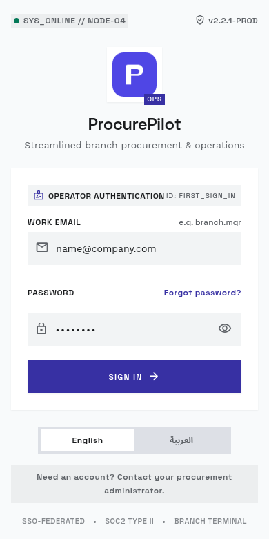
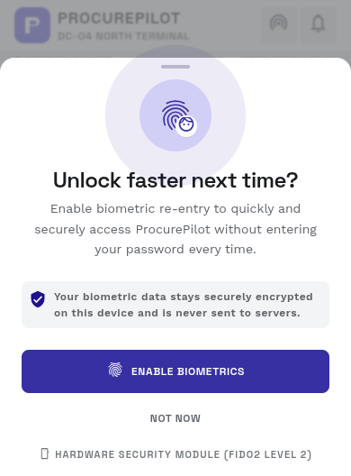
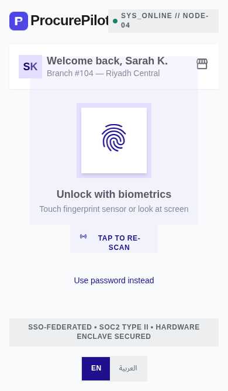
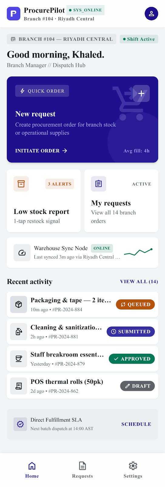
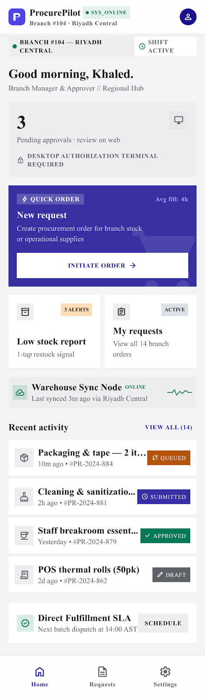
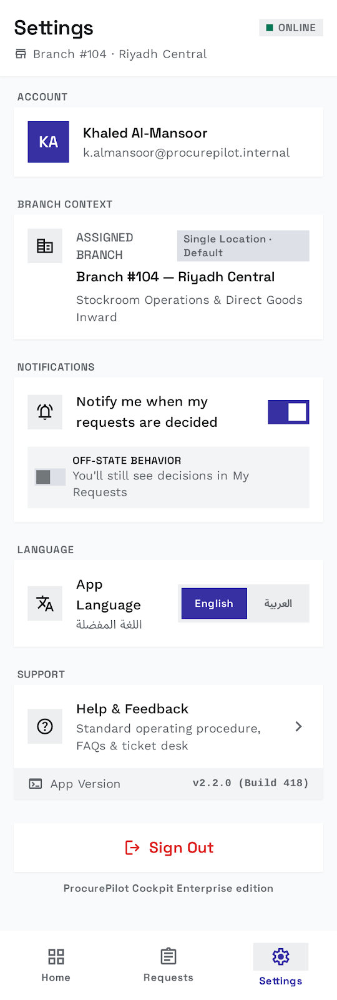

# ProcurePilot Mobile App User Documentation

> Screen-by-screen guide to the ProcurePilot mobile app (Flutter, iOS + Android).
> Last updated: 11 Oct 2026.

---

## Table of Contents

1. [What the mobile app does today](#1-what-the-mobile-app-does-today)
2. [Mobile vs Web Scope](#2-mobile-vs-web-scope)
3. [Sign In](#3-sign-in)
4. [Enable Biometric Unlock](#4-enable-biometric-unlock)
5. [App Launch (Splash / Returning-Device Unlock)](#5-app-launch-splash--returning-device-unlock)
6. [Home](#6-home)
7. [Sign Out](#7-sign-out)
8. [Language](#8-language)
9. [Purchase Requests](#9-purchase-requests)
10. [Approvals](#10-approvals)
11. [Delivery Confirmation & Quality Issue Reporting](#11-delivery-confirmation--quality-issue-reporting)
12. [Low-Stock Report](#12-low-stock-report)
13. [Push Notifications](#13-push-notifications)
14. [Roles & Permissions](#14-roles--permissions)
15. [Security, Privacy, and Auditability](#15-security-privacy-and-auditability)
16. [FAQ](#16-faq)
17. [Known Limitations](#17-known-limitations)
18. [Design Preview — Coming in Later Releases](#18-design-preview--coming-in-later-releases)

---

**About the images in this doc:** the screenshots below are mockups from the ProcurePilot
Mobile Stitch design system (`stitch_design_system_implementation`), not live captures from a
running device or simulator — this pass reviewed the app's actual source
(`apps/mobile/lib/features/`) and its own widget test suite, not a live build. Sections 3–6 have
a matching mockup and a **"Shipped vs. mockup"** note calling out anything in the image the
current build doesn't actually do. Sections 9–12 cover screens that are fully built and tested
but, for three of them, never had a design mockup produced (Approvals, Delivery Confirmation,
Quality Issue Reporting) — those sections are text-only. Section 18 uses the remaining mockups
to preview the one screen that genuinely doesn't exist yet (Settings).

For the web app's screens, see [ProcurePilot User Documentation](user-documentation.md). For
route-by-route web navigation paths, see [ProcurePilot User Flows](user-flows.md).

---

## 1. What the mobile app does today

The mobile app covers the field half of the purchase-request lifecycle, end to end:

- Signing in with the same workspace credentials used on web, with an optional biometric
  unlock for return visits.
- A role-aware home screen: everyone sees their role; request-capable roles (Owner, Buyer,
  Branch Manager) get a working **Request items** action, and approvers (Owner, Approver)
  additionally see a live count of requests awaiting their decision that opens the approval
  queue.
- Creating and submitting a purchase request — branch, cost centre, required-by date, and line
  items searched live from the catalogue — with offline queueing if the device has no
  connectivity at submit time.
- Approving or rejecting a pending request with an optional comment, from the phone.
- Confirming delivery once an order has shipped, and reporting a delivery quality issue (with
  an optional camera photo) once it has arrived — both reached from that request's detail
  screen.
- Reporting a shelf-level low-stock signal, unrelated to any specific request. This screen is
  fully built, but nothing in the shipped app currently links to it — see section 17.
- Requesting notification permission and registering the device so a tapped notification can
  open the right request directly — though no notification is actually sent to a device yet;
  see section 13 for what's real here and what's a deliberate placeholder.
- Signing out, which also removes the device's push-notification registration.
- Full English/Arabic support, including right-to-left layout in Arabic.

**What it deliberately does not do:** no product catalogue, supplier, quotation, matching,
Smart Compare, Basket Split, or savings screens — those stay web-only (section 2). There is
also no bottom navigation, no in-app Settings screen, and no in-app language switcher yet
(section 18 previews the target design for the one of these — Settings — that doesn't exist at
all today).

**Business value:** mobile now closes the field loop that used to require a desktop at every
step — request, approve, confirm delivery, flag a problem — while the high-context, evidence-
heavy workflows (quotation review, product matching, supplier comparison, savings
verification) stay on the richer web surface where source data can actually be inspected.

---

## 2. Mobile vs Web Scope

The mobile app is not a smaller copy of the web app. It is the companion surface for quick
access, identity, and the field side of the request lifecycle.

| Web capability | Mobile status today | Where to act |
|---|---|---|
| Sign in | Shipped | Mobile or web |
| Password reset / workspace creation / invitation acceptance | Web-only | Web section 1 |
| Product catalogue and suppliers | Web-only | Web sections 3–5 |
| Import, quotation upload, quotation review, and matching | Web-only; quotation capture is responsive and camera-friendly in the web app | Web sections 6–10 and 30 |
| Purchase request creation and submission | Shipped (native, with offline queueing) | Mobile section 9, or web sections 18–19 |
| Approval decisions | Shipped (native, with an optional comment) | Mobile section 10, or web section 20 |
| Delivery confirmation and quality-issue reporting | Shipped (native, photo evidence optional) | Mobile section 11, or web section 11 |
| Low-stock reporting | Built and working, but not yet linked from any screen | Direct route only today — see section 17 |
| Order tracking, accounting, and POS/inventory integration | Web-only beyond delivery/quality-issue reporting above | Web sections 11 and 33–34 |
| Smart Compare, Basket Split, Alerts, and Savings | Web-only | Web sections 12–16 |
| Team management and organisation settings | Web-only | Web sections 21–22 |
| Reports Center, report schedules, weekly digests | Web-only | Web sections 23–25 (digest deep links open web routes) |

The R3.0 capture flow is a mobile-friendly web workflow, not a native Flutter screen. On a phone,
open the web app's **Capture a Quotation** route to take a photo or upload a PDF; the native app
does not expose quotation ingestion, catalogue import, or matching.

**Data readiness:** the mobile pending-decision count and approval queue depend on the same
backend state as the web Approval Queue. If a count or list doesn't match what you expect,
check that the request was actually submitted and routed on web or mobile.

**Business value:** this boundary keeps mobile useful without diluting the evidence chain.
High-context workflows — quotation review, product matching, supplier comparison, and savings
verification — remain on web, where the user can inspect source data before making or recording
a decision. The field actions that genuinely benefit from being on the device that's physically
at the branch — requesting, approving, confirming delivery, flagging a problem — are native.

---

## 3. Sign In

**First screen after Splash on a fresh install, or whenever there's no valid stored session.**

| # | Element | Description |
|---|---------|-------------|
| 1 | **App bar — brand name** | Confirms you're in the ProcurePilot app. |
| 2 | **Email Address field** | Your workspace email. Validated as non-empty and containing `@` before submitting. |
| 3 | **Password field** | Your account password. The eye icon toggles visibility. |
| 4 | **Sign In button** | Authenticates against the same Supabase-backed workspace as the web app. Shows "Signing in..." while in flight. |

**On success:** if the device supports biometric authentication (fingerprint/face), you're taken
to the biometric enrolment offer (section 4); otherwise you go straight to Home.

**On failure:** an inline error message appears above the Sign In button (invalid credentials,
rate-limited, or a generic connection error) — the form stays filled in so you can correct and
retry.

There is no "create workspace" or "forgot password" flow on mobile in this release — use the web
app for those (section 1 of the web documentation).

**Workflow:**
1. Open the app.
2. Enter the same email and password you use on web.
3. Submit the form.
4. If biometric unlock is offered, choose whether to enable it for future launches.

**Tips:**
- Use the web password-reset flow if you cannot sign in.
- If your role or workspace access recently changed, sign out and sign in again so the mobile
  app refreshes your authority.
- Mobile uses the same tenant-isolated backend as web; you do not choose a tenant manually from
  the phone.

**Business value:** mobile sign-in gives branch and approval users fast access to operational
signals without creating a separate identity model. The same workspace membership and role
boundaries apply everywhere.

**Shipped vs. mockup:** the mockup's "Forgot password?" link and EN/AR language segmented
control aren't wired up in the shipped screen — password reset and account creation stay
web-only, and language follows the device locale (section 8). The "Need an account? Contact your
procurement administrator" footer and the SSO/SOC2 badges are mockup chrome only.

---

## 4. Enable Biometric Unlock

**Shown once, immediately after a successful sign-in, only on a device that supports biometrics.**

| # | Element | Description |
|---|---------|-------------|
| 1 | **Fingerprint icon + "Enable biometric unlock?"** | Explains that enabling lets you unlock the app next time with your device's fingerprint or face recognition instead of typing your password. |
| 2 | **Enable button** | Turns the preference on and proceeds to Home. |
| 3 | **Not now button** | Declines. Proceeds to Home; you're offered this again after your next credential sign-in (the preference is only ever set to "on" explicitly). |

Neither choice blocks you from reaching Home — biometric unlock is a convenience layered on top
of your stored session, never a replacement for it or a requirement to use the app.

**Workflow:**
1. Sign in with email and password.
2. When prompted, tap **Enable biometric unlock** or **Not now**.
3. Continue to Home.
4. On the next launch, a successful device biometric check unlocks the stored session.

**Tips:**
- Declining biometric unlock is reversible: sign in again later and you will be offered it
  again.
- Device-level biometric enrolment is managed by iOS or Android, not by ProcurePilot.
- If biometric unlock fails or is cancelled, the app falls back to password sign-in.

**Business value:** biometric unlock removes friction for frequent mobile checks while keeping
the user's verified workspace identity as the source of authority.

**Shipped vs. mockup:** the shipped sheet is simpler than the mockup — no branded top app bar,
no "hardware security module" footnote, and the copy is a shorter, more direct sentence.

---

## 5. App Launch (Splash / Returning-Device Unlock)

A brief loading screen shown every time the app starts, before Sign In or Home.

You won't normally interact with it — it decides where to send you:

1. No stored session at all -> Sign In.
2. A stored session, but biometric unlock isn't enabled -> Sign In (re-enter your password).
3. A stored session with biometric unlock enabled -> your device's biometric prompt runs
   automatically. Success refreshes your session silently and takes you to Home; a cancelled,
   failed, or unavailable biometric check falls back to Sign In rather than blocking you.

**Tips:**
- A short Splash state is normal while the app checks local session state.
- Repeated fallback to Sign In usually means biometric unlock is disabled, unavailable, or the
  stored session can no longer be refreshed.
- If your organisation removed your access, signing in again will fail with the same access
  rules enforced on web.

**Business value:** return-launch handling makes mobile quick enough for short operational
checks while still validating that the session can be trusted.

**Shipped vs. mockup:** the mockup's personalized "Welcome back, Sarah K." branch-header card,
"Use password instead" link, and EN/AR switcher aren't in the shipped screen — today it's a
plain loading indicator while the biometric check runs, with silent fallback to Sign In on
anything other than success.

---

## 6. Home

**Landing screen after sign-in or a successful biometric unlock.**

| # | Element | Description |
|---|---------|-------------|
| 1 | **App bar — "Home"** | With a sign-out icon button in the top-right corner. |
| 2 | **Your role** | Shows your workspace role (Owner, Buyer, Branch Manager, Approver, or Viewer) — the same roles as the web app (section 26 of the web documentation). |
| 3 | **Request items button** | Visible to Owner, Buyer, and Branch Manager. A live, working action — tapping it opens **New Purchase Request** (section 9) directly. |
| 4 | **Pending decisions count** | Visible to Approver and Owner roles: a card reading "N request(s) awaiting your decision," loaded from the same pending-approvals list the web Approval Queue uses. Tapping the card opens the **Approval Queue** (section 10) — this is also live, not read-only. Shows a spinner while loading and an inline error message if the count can't be fetched. |

**What's deliberately absent:** Home itself has no approve/reject control and no request form —
both are one tap away, opening the dedicated screens in sections 9 and 10. Home is a dashboard
and a launch point, not the decision surface itself.

**Workflow:**
1. Land on Home after sign-in or biometric unlock.
2. Confirm the role shown on screen matches the responsibility you expect.
3. If you're a request-capable role, tap **Request items** to start a new request.
4. If you're an approver or owner, check the pending-decision count and tap it to act.

**Tips:**
- A zero pending count means no request is currently routed to your mobile user's approval
  authority.
- If the count fails to load, sign out and back in, then use the web Approval Queue as a
  fallback.
- Home itself never lists your past requests — see the "My Requests" gap noted in section 17.

**Business value:** Home gives the user a low-friction operational signal — who they are in the
workspace and whether a request or an approval needs attention — with one tap into the screen
that actually does something about it.

**Shipped vs. mockup:** the shipped Home is simpler than the mockup — a role label, a **Request
items** button, and (for approvers) a single plain count card, with no bottom navigation bar,
"New request" hero card, Low-stock report tile, "My requests" tile, or recent-activity feed (see
section 18). The mockup's approver card also says pending approvals are reviewed on a "desktop
authorization terminal" — that line is no longer accurate to the shipped product: approve and
reject are now native mobile actions (section 10), reached directly from this same count.

---

## 7. Sign Out

Tap the sign-out icon in the Home app bar. This:

1. Best-effort deregisters this device from push notifications (a failure here doesn't block
   sign-out — you're still signed out even if the deregistration call fails).
2. Clears the biometric-unlock preference, so the next sign-in starts fresh.
3. Clears the locally stored session and returns you to Sign In.

**Tips:**
- Sign out before sharing or retiring a device.
- After sign-out, biometric unlock must be enabled again after a successful password sign-in.
- Push deregistration is best-effort so you are not trapped in the session if the network call
  fails.

**Business value:** sign-out gives users direct control over device access and notification
registration, which matters when phones are lost, reassigned, or shared in branch operations.

---

## 8. Language

The app follows the same shared English/Arabic translation catalogue as the web app
(`packages/i18n`). Arabic renders the entire layout right-to-left. There is no in-app language
switcher yet on mobile — language currently follows the device/system locale. (The target
Settings screen previewed in section 18 adds one.)

**Money amounts:** the My Requests list, Approval Queue and Request Detail show each amount as its currency code and
a grouped number: three decimal places for KWD, BHD and OMR, none for JPY, KRW, CLP, VND and ISK, and
two for every other currency (the app does not yet read each currency's configured minor units) — for
example `EGP 12,500.00`. In Arabic the digits and separators
are Arabic, for example `EGP ١٢٬٥٠٠٫٠٠`.

**Tips:**
- Change the phone's system language to Arabic to review the current mobile RTL experience.
- Use the web account menu when you need an app-level language switcher today.
- Report untranslated or clipped strings; mobile uses compact layouts, so translation length
  matters.

**Business value:** bilingual support lets the same procurement process serve English and
Arabic users without separate training material or divergent workflows.

---

## 9. Purchase Requests

Three screens cover the full request lifecycle a field user is responsible for: a list of your
own requests, a create/edit form, and a read-only detail view.

### My Requests

**Route:** `/requests`

Lists the signed-in member's own purchase requests, filterable by status.

| # | Element | Description |
|---|---------|-------------|
| 1 | **App bar — "Purchase Requests"** | With a "+" icon button that opens **New Purchase Request** below. |
| 2 | **Status filter** | All, Draft, Submitted, Approved, Rejected, or Withdrawn. |
| 3 | **Request list** | One row per request: required-by date, a status chip, and the estimated total. Tapping a row opens **Request Detail** below. |
| 4 | **Empty state** | "No purchase requests yet. Create your first request to get started." |

### New / Edit Purchase Request

**Route:** `/requests/new` (also used when editing a saved draft)

| # | Element | Description |
|---|---------|-------------|
| 1 | **Branch selector** (required) | Loaded from the workspace's branches. |
| 2 | **Cost Centre selector** (optional) | Loaded from the workspace's cost centres. |
| 3 | **Required By date field** | A date picker defaulting to today through one year out; validated as `YYYY-MM-DD`. |
| 4 | **Line items** | Each line: a **Product** field with live catalogue search (results appear after 2+ characters, debounced), a **Quantity** field, and an optional **Note**. **Add Line** adds another row; each line has its own remove action. |
| 5 | **Save Draft** | Creates the request on the first save, then saves further edits to the same draft. |
| 6 | **Submit Request** | Creates the draft if it wasn't already saved, then submits it. On success, opens **Request Detail** for the newly submitted request. |

**Offline handling:** if **Submit Request** fails because the device has no connectivity, the
submission is queued locally (stamped with an idempotency key so it can't be double-submitted)
and the screen shows "Purchase request queued — will submit when back online" instead of an
error. The queue automatically replays every pending item as soon as the device regains
connectivity.

### Request Detail

Reached from **My Requests**, immediately after submitting a new request, or (once wired to a
real push provider — section 13) from a notification tap carrying that request's ID.

| # | Element | Description |
|---|---------|-------------|
| 1 | **Request context** | Required-by date, status, requester, estimated total, a remaining-budget figure or an exceeds-budget badge when a budget applies, and an incomplete-estimate badge when some lines lack pricing. A request an RFQ guardrail drafted opens with a **Prepared automatically by a guardrail** banner naming the supplier whose quote it came from; Approval Decision shows the same banner. |
| 2 | **Line items** | One row per line: product, quantity, quantity received (once delivery has started), and estimated unit price. |
| 3 | **Confirm Delivery button** | Shown only while the request's status is `ordered`. Opens the Confirm Delivery screen (section 11). |
| 4 | **Report Quality Issue button** | Shown only while the request's status is `delivered`. Opens the Quality Issue screen (section 11). |
| 5 | **Approval section** | Read-only: a status chip, who it's assigned to, and — once decided — the approver's comment and decision timestamp. There is no approve/reject control on this screen; that lives in the Approval Queue (section 10). |

**Current display limitation:** a line's product is shown by its internal product ID rather
than its catalogue name — the same friendly-name-resolution gap noted on the equivalent web
screen (section 19 of the web documentation).

**Business value:** a structured, native request flow captures what the web form captures —
who needs the item, where, by when, and at what estimated cost — from the device a branch user
already has in hand, and keeps working through a dead signal thanks to offline queueing.

---

## 10. Approvals

### Approval Queue

**Route:** `/approvals`

Lists every request currently pending the signed-in approver's decision — the same backend list
that drives the Home pending-decision count (section 6).

| # | Element | Description |
|---|---------|-------------|
| 1 | **App bar — "Approval Queue"** | |
| 2 | **Queue list** | One row per pending request: requester, required-by date, and estimated total. Tapping a row opens the decision screen below. |
| 3 | **Empty state** | "No requests are currently awaiting your decision." |

### Approval Decision

**Route:** `/approvals/detail`

| # | Element | Description |
|---|---------|-------------|
| 1 | **Request context** | The same context block shown on Request Detail (section 9): required-by date, status, requester, estimated total, budget status, and line items. |
| 2 | **Comment field** (optional) | Free text, 2–4 lines, attached to whichever decision you make. |
| 3 | **Approve button** | Records an approval with the comment, if any. |
| 4 | **Reject button** | Records a rejection with the comment, if any. |
| 5 | **Result message** | Shown inline after a decision: a success confirmation, or — if someone else (on mobile or web) already decided the request first — a specific "already decided" message instead of a generic error. |

**Business value:** approvers get the same decision authority on mobile as on web — context,
an optional comment, and approve/reject — so a pending request doesn't have to wait for its
approver to reach a desktop. Every decision still lands in the same audit trail the web
Approval Queue writes to.

---

## 11. Delivery Confirmation & Quality Issue Reporting

Two screens close the loop on what actually arrived, reached only from a specific request's
Detail screen (section 9) once its status makes the action relevant.

### Confirm Delivery

**Route:** `/delivery/confirm` — reached from an `ordered` request's **Confirm Delivery** button.

| # | Element | Description |
|---|---------|-------------|
| 1 | **Request context** | The same context block as Request Detail. |
| 2 | **Quantity received fields** | One per line, pre-filled with whatever was last recorded for that line (or the ordered quantity if nothing has been recorded yet) — so reopening this screen after a partial delivery lets you adjust the running total rather than starting over. Each field shows the originally ordered quantity as a helper. |
| 3 | **Confirm Delivery button** | Submits the quantities. A specific message appears if the request isn't actually in an ordered state anymore, or if the submitted lines don't validate. |

### Report Quality Issue

**Route:** `/delivery/qualityIssue` — reached from a `delivered` request's **Report Quality
Issue** button.

| # | Element | Description |
|---|---------|-------------|
| 1 | **Request context** | The same context block as Request Detail. |
| 2 | **Description field** (required) | Free text describing the issue — damage, defect, wrong item, etc. |
| 3 | **Photo Evidence (Optional)** | A **Take Photo** button opens the device camera via the same plugin used throughout the app; if the camera isn't available on this device, the screen says so instead of showing a non-functional button. A captured photo can be previewed and removed before submitting. A capture that's interrupted (for example, Android reclaiming the app's process while the camera is in front) is recovered automatically when the screen reopens. |
| 4 | **Submit Report button** | Posts the description, then uploads the photo if one was captured. A specific message appears if the request isn't actually in a delivered state anymore. |

**Offline handling:** if submission fails for a connectivity reason, the report — including a
locally copied photo file, if one was captured — is queued and sent automatically once the
device is back online, using the same idempotency-key pattern as purchase requests (section 9).

**Business value:** both screens put delivery evidence capture where delivery actually happens
— at the dock or the shelf, on the device already in hand — instead of requiring someone to
remember the details until they're back at a desktop. Photo evidence is optional by design
(FR-007): a missing camera or a declined permission never blocks the report itself.

---

## 12. Low-Stock Report

**Route:** `/lowStock`

A lightweight "shelf is running low" signal, unrelated to any specific purchase request — the
screen itself is fully built and tested, but **nothing in the shipped app currently navigates
to it**. It's reachable today only by its route name; see section 17.

| # | Element | Description |
|---|---------|-------------|
| 1 | **Product field** | The same live catalogue search used on the request form. |
| 2 | **Branch selector** | Loaded from the workspace's branches; auto-selected if the workspace has exactly one. |
| 3 | **Count Remaining field** (optional) | Free-text numeric entry for how much is left, if known. |
| 4 | **Submit button** | Records the report independently of any purchase request. |

**Offline handling:** the same idempotency-keyed offline queue used for requests and quality
issues applies here — a submission made without connectivity is queued and shows "Low stock
report queued — will send when back online," then replays automatically once the device is
back online.

**Business value:** the intent is a lightweight early-warning path distinct from raising a full
purchase request — but it's currently unrealized in practice, since there's no way for a user
to reach this screen without someone handing them the route name directly.

---

## 13. Push Notifications

Not a navigable screen — this runs in the background after sign-in.

| Step | What happens |
|---|---|
| **Permission request** | After sign-in, the app asks the OS for notification permission. |
| **Device registration** | If permission is granted, the app registers this device (platform + a push token) with the backend. A decline, or a platform where permission isn't available, simply skips registration — sign-in proceeds normally either way. |
| **Notification tap routing** | A notification carrying a `purchase_request_id` payload opens that request's Detail screen (section 9) directly. |
| **Deregistration** | Signing out best-effort deregisters the device (section 7). |

**What this isn't yet:** the permission, registration, and tap-routing plumbing above is real
and covered by tests — but the push token generated today is an honest, locally-generated
placeholder, not a real Firebase Cloud Messaging or Apple Push Notification service token. The
backend's actual message-sending provider integration is intentionally stubbed for this
release, so no push notification is actually delivered to a device yet. What's shipped is the
scaffold a real provider will plug into, including the deep-link path that's already tested
end-to-end.

**Business value:** once a real push provider is wired in, this scaffold means a request's
state change (approved, ordered, delivered) can reach the right phone immediately and open
directly to the relevant screen — without any further client-side work.

---

## 14. Roles & Permissions

Mobile uses the same workspace roles as the web app, gated by two client-side checks: whether
the role can raise requests, and whether it should see approval decisions.

| Role | Mobile experience today |
|------|--------------------------|
| **Owner** | Everything: create/submit requests, approve/reject, confirm delivery, report quality issues, and (once reachable — section 17) low-stock reports. |
| **Buyer** | Create/submit requests, confirm delivery, report quality issues. No approval decisions — Buyer isn't an approver role on mobile or web. |
| **Branch Manager** | Create/submit requests, confirm delivery, report quality issues. No approval decisions. |
| **Approver** | Approve/reject from the Approval Queue. No request-creation button on Home — Approver isn't a request-raising role on mobile or web. |
| **Viewer** | Can sign in, see role, and sign out. No write action is available. |

**Notes:**
- Roles are assigned and changed from web Team Management.
- Mobile does not expose admin controls, catalogue editing, or supplier editing in this
  release.
- Backend authorization remains the final enforcement point; a hidden or missing button on
  mobile is never the only permission control.

**Business value:** role-aware mobile access lets each user see only the operational actions
that matter to them, while preserving the accountability boundaries configured by the owner.

---

## 15. Security, Privacy, and Auditability

Mobile follows the same security model as the web app: authenticated API calls, verified
workspace membership, role-based access, and database-enforced tenant isolation.

| Area | Mobile behaviour |
|---|---|
| **Tenant isolation** | The app never asks the user to type or choose a tenant identifier. Workspace access comes from the authenticated session. |
| **Stored session** | A local session is used for return visits. Biometric unlock gates convenience access to that stored session when enabled. |
| **Offline queue** | Requests, quality-issue reports, and low-stock reports submitted without connectivity are persisted locally (in an on-device Hive store) with a stamped idempotency key, and replayed automatically once connectivity returns — never silently dropped. |
| **Push device token** | Sign-out attempts to deregister the device so future notifications are not sent to a signed-out device. Today's token is a placeholder (section 13), not a real provider token. |
| **Audit trail** | Requests, approval decisions, delivery confirmations, and quality-issue reports made on mobile write to the same backend records and audit trail as their web equivalents — mobile is a second client against the same evidence chain, not a separate one. |
| **Human authority** | The mobile app never executes or autonomously authorises purchasing. Approve/reject is always an explicit human tap, exactly as on web. |

**Business value:** mobile speeds up both awareness and action without weakening the evidence
chain. Every commercial action it supports — a request, a decision, a delivery confirmation, a
quality-issue report — is auditable through the same backend records the web app writes to.

---

## 16. FAQ

**Q: Can I submit a purchase request from my phone?**
A: Yes. Tap **Request items** on Home, fill in branch, required-by date, and at least one line
item, then **Submit Request**. If you're offline, it queues and sends automatically once you're
back online.

**Q: I'm an approver — can I approve or reject from my phone?**
A: Yes. Tap the pending-decision count on Home (or open the Approval Queue directly) and use
the Approve/Reject buttons with an optional comment.

**Q: Where do I see my own past requests?**
A: The "My Requests" screen exists and works, but nothing in the app currently links to it —
see the gap noted in section 17. For now, use the web app's Purchase Requests screen (web
section 18) to browse your history.

**Q: Why can't I confirm delivery or report a quality issue on an older request?**
A: Both actions live on that request's Detail screen, which today is only reached right after
you submit a request, or from a notification tap that names a specific request. Since
notifications aren't actually delivered yet (section 13) and there's no "My Requests" entry
point (section 17), there's currently no reliable way back to an older request's Detail screen
from inside the app. Use the web app's Order Tracking or Purchase Requests screens instead.

**Q: Does signing in request notification permission?**
A: Yes, right after sign-in. Declining is safe — it just skips device registration and nothing
else changes.

**Q: Will I actually receive a push notification?**
A: Not yet. The permission and registration flow is real, but the backend's push-sending
provider is a deliberate placeholder in this release — see section 13.

**Q: Do I need to sign in every time I open the app?**
A: Only if you haven't enabled biometric unlock, or your device doesn't support it. Otherwise, a
fingerprint or face check unlocks your existing session.

**Q: What happens if I decline biometric unlock?**
A: Nothing is lost — you're taken to Home immediately, and you can still use the app normally
with password sign-in each time. You'll see the offer again after your next credential sign-in.

**Q: Can mobile see product, supplier, quotation, matching, compare, or savings pages?**
A: Not in this release. Those are web-only because they require denser tables, source evidence,
comparison data, and audit context.

**Q: Is biometric unlock mandatory?**
A: No. It is optional and can always fall back to password sign-in.

---

## 17. Known Limitations

| # | Area | Limitation |
|---|------|-----------|
| 1 | Navigation | "My Requests" (section 9) and "Low-Stock Report" (section 12) are both fully built and tested, but no button, link, or menu anywhere in the shipped app navigates to either — they're reachable only by their route name. Home's **Request items** button opens the New Request form directly, not a list. |
| 2 | Navigation | Because of #1, a request's Detail screen — and therefore Confirm Delivery and Report Quality Issue — currently has no reliable in-app path once you've navigated away from it, other than a notification tap naming that specific request. Push notifications aren't actually delivered yet (section 13), so in practice this path doesn't fire today outside of tests. |
| 3 | Push notifications | The device-registration token is an honest local placeholder, not a real Firebase/APNs token; no push notification is actually sent to a device in this release (section 13). |
| 4 | Navigation | No bottom navigation or Settings screen exists yet — every screen is reached by a specific action from wherever it's linked (see section 18 for the target design). |
| 5 | Language | No in-app language switcher; the app follows the device locale. |
| 6 | Sessions | If a session is revoked server-side, the mobile client's own refresh-token exchange happens directly against Supabase Auth rather than through ProcurePilot's API — this path has a documented gap in test coverage, not a confirmed bug (see the engineering notes in `apps/api/tests/integration/test_session_revocation.py`). |
| 7 | Documentation images | Mobile screenshots are design mockups, not simulator captures, and three shipped screens (Approvals, Delivery Confirmation, Quality Issue Reporting) never had a mockup produced at all. The shipped-vs-mockup notes and the text-only sections are the source of truth for current behaviour. |
| 8 | Commercial modules | Catalogue, suppliers, import, quotations, matching, compare, basket split, alerts, savings, team management, and organisation settings are web-only today. |

If you hit anything beyond this list, flag it to the product team.

---

## 18. Design Preview — Coming in Later Releases

Most of the screens originally previewed in this section are now shipped — see sections 9–12.
**Settings is the one screen below that still doesn't exist in the app at all.**

### Settings

A dedicated Settings screen: account info, assigned branch, a notification toggle, an in-app
language switcher, help/feedback, app version, and sign-out. Today, the only settings-like
control in the app is the sign-out icon in the Home app bar (section 7); language follows the
device locale (section 8).

**Expected workflow:** review account details, adjust notifications and language, reach help,
and sign out from one predictable place.

**Business value:** a mobile Settings screen would make device-specific preferences visible
without pushing users back to the web app for small account tasks.

### Bottom navigation

The mockups throughout this document (Home, My Requests, Request Detail, Low-Stock Report) show
a persistent bottom navigation bar (Home / Requests / Settings). The shipped app has no bottom
navigation — every screen today is reached by a specific button or link from wherever it's
documented above, which is also why sections 9 and 12 note missing entry points rather than a
missing tab.

---

## Getting Help

- In the web app: **Account menu -> Contact support** opens an email to support.
- Email: support@iron-sys.com.
